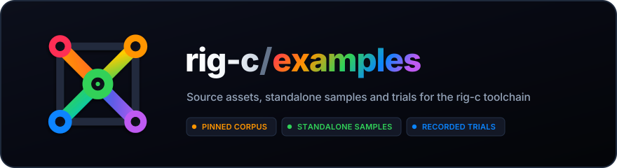
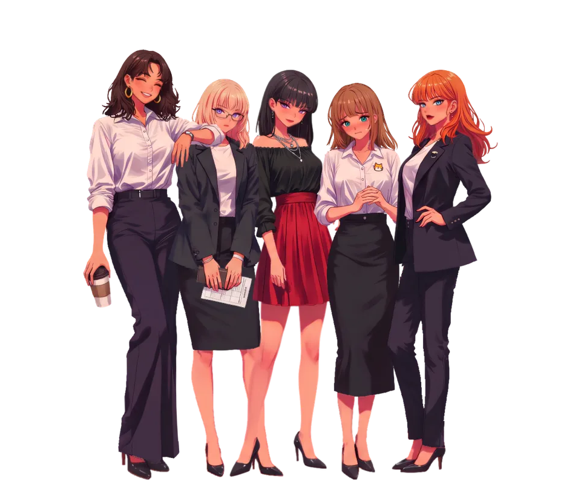
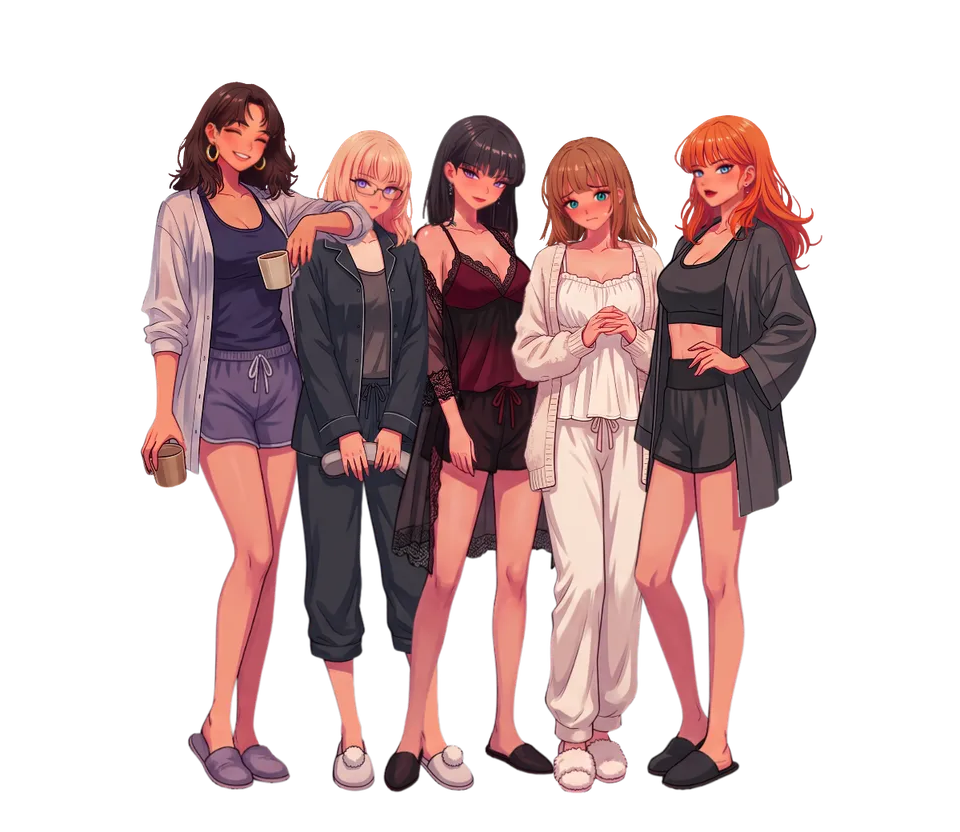
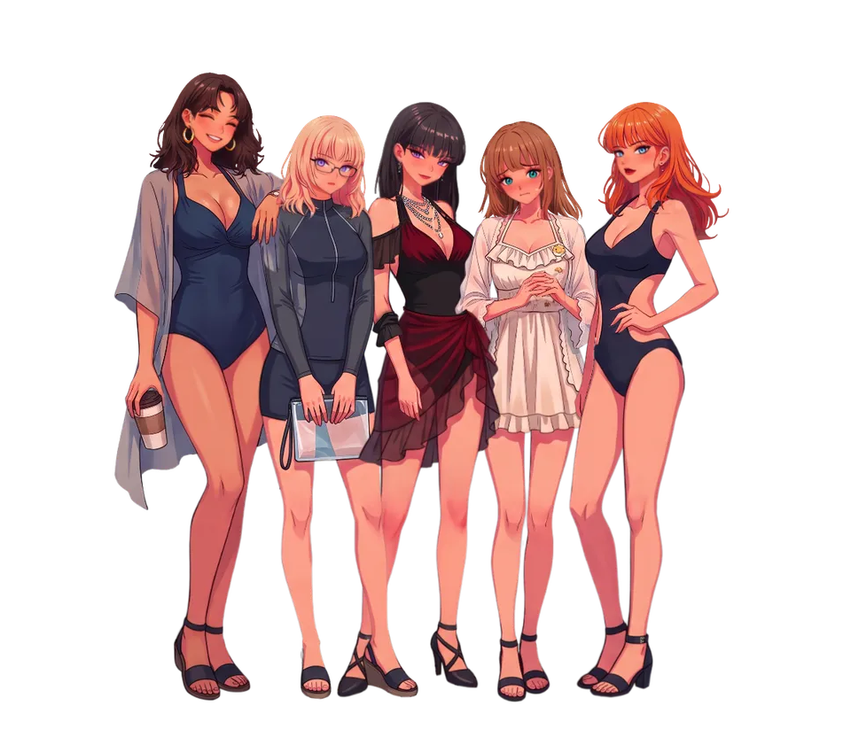
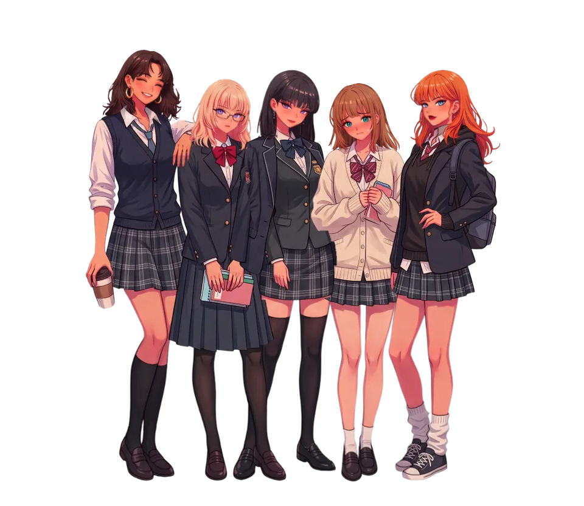

<p align="center">
  
</p>

# rig-c/examples

The examples of the rig-c toolchain ([`@rig-c/core`](https://github.com/rig-c/core),
[`@rig-c/parts`](https://github.com/rig-c/parts), [`@rig-c/play`](https://github.com/rig-c/play)),
as source assets, standalone samples and trials:

- **The corpus** — the inputs the toolchain's gates fetch by a pinned commit:
  `demo`, `wind`, `scarf`, `reference-demo`, `reference-sample`,
  `three-quarter`, `look` and `family`. Their paths are frozen. `@rig-c/parts`'
  `scripts/fetch-examples.sh` copies files from a commit it pins, and
  `@rig-c/play`'s fixture pins a commit too, so a change to a corpus
  directory reaches a consumer only when that consumer moves its pin.
- **Standalone samples** — [`rigboy`](rigboy/README.md), the first SD-style
  motion character rig here; not added to a consumer's pinned corpus by this
  example.
- **The trials** — what was tried with the toolchain to answer "does this
  work?", kept whether it passed or failed, under `trials/` (see
  [Trials](#trials)).

This repository was `rig-c/parts-examples` until 2026-10-23. Links and
records that still name `rig-c/parts-examples` refer to it; GitHub
redirects them.

For each standalone character, the corpus holds the painting, the two images
See-through was fed, and the two See-through layer sets that came back.
rig-parts tracks the light half of each example — the character config, the
proposal, the reference implementation's outputs and small contact sheets —
under `examples/<key>/`, and fetches this repository into its gitignored
`examples/<key>/inputs/`.

The standalone input examples listed under “Layout” were generated for
publication. Their paintings are generated images of original characters,
made from public checkpoints with no LoRA and no text naming or describing
any existing character; they depict no third-party character. The generation
records and checkpoint credits below concern those standalone examples.

## Family: repairing the result

| Office | Homewear |
| --- | --- |
|  |  |
| Swimwear | Uniform |
|  |  |

Four separately labeled transparent previews use the current twenty serving rigs,
with the same breathing, gentle breeze and deterministic blink. Each README
preview preserves the existing office presentation: 960×832, 67 frames,
3.333 seconds and quality80 across all four outfits. [Render recipe](family/scripts/render-readme-preview.mjs) · Per-outfit frames, timing, sources and loop proofs: [office](family/docs/family-preview.json) · [homewear](family/docs/family-preview-homewear.json) · [swimwear](family/docs/family-preview-swimwear.json) · [uniform](family/docs/family-preview-uniform.json).
The renderer gives no closure verdict; the decoded last→first step is no
larger than the largest step between adjacent frames, and the one-period
endpoint difference is reported. Serving
art, mesh, physics, motion, player and camera are unchanged.

The [Family case study](family/REPAIR_CASE_STUDY.md) follows five characters
from a group painting through repairs to their alpha edges, mesh bindings and
physics. These matched Naru frames show one repair: restoring the source edge
after a low-resolution binary mask had turned it into steps.

Family has a separate [group-image and repair history](family/README.md);
the standalone examples' checkpoint and no-LoRA statements do not describe
its source. Its later [Naru rearhair completion](family/naru/BACKHAIR_REGENERATION.md)
is new generated artwork, distinct from the source-backed edge repairs.

| Before | After |
| --- | --- |
|  |  |

The study records rejected fixes, measured motion conditions and remaining
limits, including where alpha was inferred or new artwork generated. The
[Family guide](family/README.md) includes the local interactive viewer.

## Trials

A trial is one directory `trials/<yyyy-mm-dd>-<slug>/` whose README states the
question, the inputs and their licence, the exact commands and tool pins, the
measurement, a PASS, FAIL or PARTIAL verdict, the alternatives rejected and the
limits. [trials/README.md](trials/README.md) is the convention and
[trials/TEMPLATE.md](trials/TEMPLATE.md) the skeleton. A trial never edits a
corpus directory.

## Layout

```
<key>/
  painting.png                  the generated painting, 1664x2432
  inputs/st_input_full.png      what See-through's full-body run was fed (the painting, white-padded to a square)
  inputs/st_input_head.png      what its head run was fed (a square crop of the painting)
  layers/full/layers.json       the ComfyUI See-through wrapper's manifest for the full run
  layers/full/meta.json         the run record: elapsed seconds, settings, layer names
  layers/full/parts/<tag>.png   one RGBA PNG per See-through layer, named by its tag
  layers/head/...               the same for the head run
  generation.json               the generation record: checkpoint, sampler, control, seed, prompts, and how the seed was chosen
look/config.json                the look head-turn demo's mesh, bone, depth-turn and slider authoring (@rig-c/adapters issue #107)
look/animations.json            the look demo's roll, gaze_x and gaze_y tracks
look/layers/*/parts/*_depth.png the See-through scalar depth maps for the look demo's 2.5D head and body turn
rigboy/generation/             the selected profile control, pose points and exact generation graph
rigboy/controls.js             player helpers for the aim dial and optional world travel
rigboy/config.json             the standalone character's mesh, bone and control authoring
rigboy/motions.json            keyed motion clips and the aim dial's pose range
rigboy/assembled/              structural pieces from the existing layer runs
rigboy/rig/                    the rig and motion specs with their part images
rigboy/build/                  the packed player model, atlas and page
rigboy/preview.webp            a labeled montage of seven motion/control samples
reference-demo/python-reference/  the reference implementation's rendered idle loop (gif, webp) and its two README images, kept for comparison with what rig-parts renders
reference-demo/candidates.json  that character's eighteen measured candidates (figures only; the other images are not published)
scarf/candidates.json           scarf's six measured seeds (figures only; the other images are not published)
demo/candidates.json            the demo's sixteen candidates, each with a one-line reading of its hands (the other images are not published)
demo/pose.json                  the OpenPose pose file the demo was painted on (rig-parts issue #198)
demo/detail_mask.png            the two hand boxes the demo's hand-detailer pass repainted
demo/detail_graph.json          that pass's ComfyUI graph
wind/candidates.json            wind's twenty-four candidates, each with its `rig-parts painting` screen (figures only; the other images are not published)
wind/pose.json                  the OpenPose pose file wind was painted on
```

Paths inside `meta.json` (`image`) are relative to the character directory.
`painting.png` still carries the ComfyUI workflow it was generated by, in its
`prompt` text chunk; it is left there as provenance.

The standalone paintings:

| key | seed | chosen from | See-through layers | notes |
|---|---|---|---|---|
| `demo` | 71006, then a hand-detailer pass | 16 candidates over two checkpoints and three poses (`candidates.json`), read by eye at the hands | 29 full + 29 head | the README character from rig-parts issue #227: twin tails, a bow, sleeves and a short layered skirt, arms held away from the body so the hands are painted apart and open |
| `scarf` | 72004 (the same six seed numbers as `reference-demo`'s `shrine` variant, under a different prompt) | 6 seeds (`candidates.json`) | 29 full + 29 head | shoulder-length black hair, a very long red scarf with both ends hanging free, a knit sweater and a pleated skirt: a hanging element the others lack |
| `reference-sample` | 70011 | 12 seeds in two batches | 29 full + 29 head | the plain fixture: the reference rigged it from its own proposal with no hand edit. Published as `sample` until rig-parts issue #227 |
| `reference-demo` | 71004 | 18 candidates over three prompt variants (`candidates.json`) | 29 full + 29 head | the reference implementation's twin-tail character with clasped hands; the README character until rig-parts issue #227 took it off display for its malformed fingers. Published as `demo` until then |
| `three-quarter` | 250011 | 10 seeds in two batches under two pose wordings (`generation.json`), read by eye at the face | 29 full + 29 head | the head turned toward image left and tilted, painted to read rig-parts' head-frame turn figures against the frontal faces (rig-parts issue #250); inputs only, no rig-parts example reads it yet |
| `wind` | 372108 | 24 seeds under three wordings (`candidates.json`), screened by `rig-parts painting`, the seven best re-read with eye-placed joints | 29 full + 29 head | a figure for wind interaction (rig-parts issue #372): very long twin tails wrapped in red ribbons and a wide two-layer skirt, arms and legs held apart so the painting passes `rig-parts painting` |
| `look` | 2 (design `C`) | 12 candidates over three short-hair designs (`generation.json`), screened by shoulder-clearance and frontal-pose bars | 29 full + 29 head (with 29 + 29 depth maps) | the pointer-driven head-turn bust demo (`@rig-c/adapters` issue #107): short high-tied twin tails that clear the shoulders, a dark navy sweater over a collared shirt and green tie, with `config.json` and `animations.json` |
| [`rigboy`](rigboy/README.md) | 781301 | paired public-checkpoint comparison, selected by source and layer review (`generation.json`) | 29 full + 29 head | original short-haired side-profile boy, jacket, trousers, orange boots and a two-handed sci-fi toy grip; a standalone sample with seven modest motion/control samples and [measured limits](rigboy/README.md#measured-limits) |
| [`rigboy/v2`](rigboy/v2/README.md) | 805082 | articulated limb pieces and joint caps ([`rigboy/v2/README.md`](rigboy/v2/README.md)) | 20 region pieces (`rigboy/v2/images/`) | v2 articulated-piece rig (40 bones, 28 slots, 0 meshes) mapped onto the public-domain Spineboy skeleton and nine human animations |

`reference-demo` and `reference-sample` are the two characters the reference
implementation ran: rig-parts keeps them as fixtures, compared against that
implementation's outputs, and no longer shows them. Their files are as they
were published under `demo/` and `sample/` (the records inside still say
`"key": "demo"` and `"key": "sample"`, the key their rig-parts configs keep, because the
reference's outputs name the skeleton after it).

## How they were made

Each standalone character's `<key>/generation.json` ([`demo`](demo/generation.json),
[`scarf`](scarf/generation.json), [`reference-sample`](reference-sample/generation.json),
[`reference-demo`](reference-demo/generation.json), [`three-quarter`](three-quarter/generation.json),
[`wind`](wind/generation.json), [`look`](look/generation.json), [`rigboy`](rigboy/generation.json))
records the checkpoint, sampler, steps, CFG, latent size, upscaler and downscale,
ControlNet pose or txt2img settings, candidate screening, selection rule, and
verbatim positive and negative prompts (`wind/generation.json` also splits the
`POSITIVE_HEAD` and `NEGATIVE_HEAD` prefixes from `rig-parts` `src/graphs.ts`).
Per-seed candidate measurements and alternate prompt variants live in
`reference-demo/candidates.json`, `scarf/candidates.json`, `demo/candidates.json`
and `wind/candidates.json`; OpenPose control skeletons live in `demo/pose.json`,
`wind/pose.json` and `rigboy/generation/`; and `demo`'s second-pass hand detailer
is recorded in `demo/detail_graph.json` and `demo/detail_mask.png`.

**Layers.** Each character has two [See-through](https://github.com/shitagaki-lab/see-through)
runs (`full` on `inputs/st_input_full.png` and `head` on `inputs/st_input_head.png`)
whose settings, layer tags and elapsed seconds are in `<key>/layers/{full,head}/meta.json`,
with per-character input geometry recorded in `three-quarter/generation.json`,
`wind/generation.json` and `look/generation.json`. For the four earlier corpus
characters where `generation.json` and `meta.json` omit wrapper and crop provenance:
`reference-sample` and `reference-demo` ran through
[ComfyUI-See-through](https://github.com/jtydhr88/ComfyUI-See-through) tag `0.5.0`
(commit `98d754bf04f668647919ab750eccb0e0640faa81`, RGB inputs, `reference-demo`
head crop `790x790`); `scarf`, `demo`, `three-quarter` and `wind` were queued by
`rig-parts comfy seethrough` (wrapper version unrecorded) on inputs cut by
`rig-parts inputs` (`x 384` with `384 px` of white padding either side for `full`;
RGBA with alpha 255 for `scarf` and `demo`; `scarf` head crop `370x370` at
`[639, 144, 1009, 514]`; `demo` head crop `1125x1125` at `[268, 0, 1393, 1125]`
after `rig-parts propose --head-box` shifted it down `269 px`).

## Terms

The generated images and JSON in this repository are released under the MIT
licence ([LICENSE](LICENSE)).

The generation records and checkpoint credits in this section concern the
standalone corpus examples only; Family's source is described in
[family/README.md](family/README.md), and each trial's README states where its
inputs came from and under what licence. A trial commits only files that may be
released under [LICENSE](LICENSE); anything that may not stays out, and the
trial's README says what was withheld.

Each checkpoint's own terms are its publisher's.

`demo`, `three-quarter`, `wind`, `rigboy` — **Hassaku XL (Illustrious)**, "v1.3 - Style A", by Ikena,
<https://civitai.com/models/140272>. Credit, as sharing it requires:

> Painted with Hassaku XL (Illustrious) v1.3 Style A by Ikena
> (https://civitai.com/models/140272), Fair AI Public License 1.0-SD.

The model page's "Version and License info" section, observed 2026-10-11,
reads "All Models using the Fair AI Public License 1.0-SD license". Its API
record (`https://civitai.com/api/v1/models/140272`), observed 2026-10-11:
`allowCommercialUse` is `["RentCivit", "Rent", "Image"]`, `allowNoCredit` is
`false` (credit the model when sharing — the line above), `allowDerivatives`
is `true`, `allowDifferentLicense` is `false`.

`reference-sample`, `reference-demo`, `scarf` — **[Pony Diffusion V6 XL](https://civitai.com/models/257749)**, "V6 (start with this one)". On the CivitAI model page's
API record for Pony Diffusion V6 XL (`https://civitai.com/api/v1/models/257749`),
observed 2026-09-27: `allowCommercialUse` is `["Image", "RentCivit"]`,
`allowNoCredit` is `false` (credit the model when sharing — this README does),
`allowDerivatives` is `true`, `allowDifferentLicense` is `false`. Those fields
are the publisher's statement about the model, reproduced here as observed;
they are not a licence this repository grants. The same holds for the
Hassaku XL fields above. `rigboy` uses the credited v1.3 Style A version
([publisher version](https://civitai.com/models/140272?modelVersionId=1240288));
its generation record retains that provenance without claiming an unrestricted
licence for the checkpoint. `look` (like `dancer/painting_meta.json` and
`trials/2026-10-17-txt2img-frontal-half-body`) records the checkpoint file name
`novaAnimeXL_ilV80.safetensors` from its generation run; the run's records
carry no publisher URL, licence or binary hash for that checkpoint.

See-through and its wrapper are not redistributed here, only their output.

## How rig-parts fetches this

`bun run fetch-examples` in a rig-parts checkout runs
`scripts/fetch-examples.sh`, which clones this repository at the commit the
script pins — never a branch — and copies, for every `examples/<key>/` of
rig-parts that has a counterpart here — the same key on both sides, so
rig-parts' `examples/reference-demo/` reads `reference-demo/` here —
`painting.png`, `inputs/*` and `layers/` into `examples/<key>/inputs/`. It keeps any file already on disk,
prints what it copied and kept per character, and names any rig-parts
example with no counterpart here. A new commit here reaches rig-parts only
when the pin there is moved.
