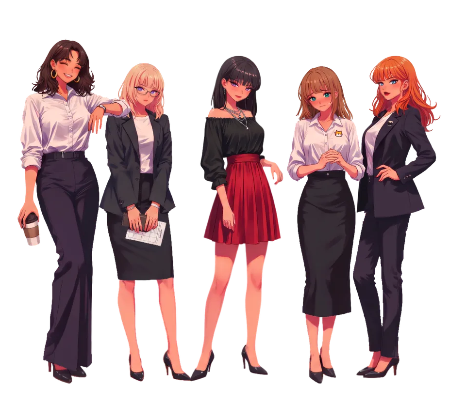

# parts-examples

The heavy inputs of the public example characters of
[`@rig-c/parts`](https://github.com/rig-c/parts) (the `rig-parts` command): for each character, the
painting, the two images See-through was fed, and the two See-through layer
sets that came back. rig-parts tracks the light half of each example — the
character config, the proposal, the reference implementation's outputs and
small contact sheets — under `examples/<key>/`, and fetches this repository
into its gitignored `examples/<key>/inputs/`.

The standalone input examples listed under “Layout” were generated for
publication. Their paintings are generated images of original characters,
made from public checkpoints with no LoRA and no text naming or describing
any existing character; they depict no third-party character. The generation
records and checkpoint credits below concern those standalone examples.

## Family: repairing the result



The accepted five-rig composition, rendered with its real idle animation and
physics: a 960 × 832, 3.33-second animated WebP (7.46 MB) with transparency. [Render recipe](family/scripts/render-readme-preview.mjs) · [Source hashes and timing](family/docs/family-preview.json).

The [Family case study](family/REPAIR_CASE_STUDY.md) follows five characters
from a group painting through repairs to their alpha edges, mesh bindings and
physics. These matched Naru frames show one repair: restoring the source edge
after a low-resolution binary mask had turned it into steps.

Family has a separate [group-image and repair history](family/README.md);
the standalone examples' checkpoint and no-LoRA statements do not describe
its source. Its later [Naru rearhair completion](family/naru/BACKHAIR_REGENERATION.md)
is new generated artwork, distinct from the source-backed edge repairs.

| Before | After |
| --- | --- |
|  |  |

The study records rejected fixes, measured motion conditions and remaining
limits, including where alpha was inferred or new artwork generated. The
[Family guide](family/README.md) includes the local interactive viewer.

## Layout

```
<key>/
  painting.png                  the generated painting, 1664x2432
  inputs/st_input_full.png      what See-through's full-body run was fed (the painting, white-padded to a square)
  inputs/st_input_head.png      what its head run was fed (a square crop of the painting)
  layers/full/layers.json       the ComfyUI See-through wrapper's manifest for the full run
  layers/full/meta.json         the run record: elapsed seconds, settings, layer names
  layers/full/parts/<tag>.png   one RGBA PNG per See-through layer, named by its tag
  layers/head/...               the same for the head run
  generation.json               the generation record: checkpoint, sampler, control, seed, prompts, and how the seed was chosen
reference-demo/python-reference/  the reference implementation's rendered idle loop (gif, webp) and its two README images, kept for comparison with what rig-parts renders
reference-demo/candidates.json  that character's eighteen measured candidates (figures only; the other images are not published)
scarf/candidates.json           scarf's six measured seeds (figures only; the other images are not published)
demo/candidates.json            the demo's sixteen candidates, each with a one-line reading of its hands (the other images are not published)
demo/pose.json                  the OpenPose pose file the demo was painted on (rig-parts issue #198)
demo/detail_mask.png            the two hand boxes the demo's hand-detailer pass repainted
demo/detail_graph.json          that pass's ComfyUI graph
wind/candidates.json            wind's twenty-four candidates, each with its `rig-parts painting` screen (figures only; the other images are not published)
wind/pose.json                  the OpenPose pose file wind was painted on
```

Paths inside `meta.json` (`image`) are relative to the character directory.
`painting.png` still carries the ComfyUI workflow it was generated by, in its
`prompt` text chunk; it is left there as provenance.

The six characters:

| key | seed | chosen from | See-through layers | notes |
|---|---|---|---|---|
| `demo` | 71006, then a hand-detailer pass | 16 candidates over two checkpoints and three poses (`candidates.json`), read by eye at the hands | 29 full + 29 head | the README character from rig-parts issue #227: twin tails, a bow, sleeves and a short layered skirt, arms held away from the body so the hands are painted apart and open |
| `scarf` | 72004 (the same six seed numbers as `reference-demo`'s `shrine` variant, under a different prompt) | 6 seeds (`candidates.json`) | 29 full + 29 head | shoulder-length black hair, a very long red scarf with both ends hanging free, a knit sweater and a pleated skirt: a hanging element the others lack |
| `reference-sample` | 70011 | 12 seeds in two batches | 29 full + 29 head | the plain fixture: the reference rigged it from its own proposal with no hand edit. Published as `sample` until rig-parts issue #227 |
| `reference-demo` | 71004 | 18 candidates over three prompt variants (`candidates.json`) | 29 full + 29 head | the reference implementation's twin-tail character with clasped hands; the README character until rig-parts issue #227 took it off display for its malformed fingers. Published as `demo` until then |
| `three-quarter` | 250011 | 10 seeds in two batches under two pose wordings (`generation.json`), read by eye at the face | 29 full + 29 head | the head turned toward image left and tilted, painted to read rig-parts' head-frame turn figures against the frontal faces (rig-parts issue #250); inputs only, no rig-parts example reads it yet |
| `wind` | 372108 | 24 seeds under three wordings (`candidates.json`), screened by `rig-parts painting`, the seven best re-read with eye-placed joints | 29 full + 29 head | a figure for wind interaction (rig-parts issue #372): very long twin tails wrapped in red ribbons and a wide two-layer skirt, arms and legs held apart so the painting passes `rig-parts painting` |

`reference-demo` and `reference-sample` are the two characters the reference
implementation ran: rig-parts keeps them as fixtures, compared against that
implementation's outputs, and no longer shows them. Their files are as they
were published under `demo/` and `sample/` (the records inside still say
`"key": "demo"` and `"key": "sample"`, the key their rig-parts configs keep, because the
reference's outputs name the skeleton after it).

## How they were made

**Painting** (`reference-sample`, `reference-demo`, `scarf`). ComfyUI, checkpoint `ponyDiffusionV6XL_v6StartWithThisOne.safetensors`
([Pony Diffusion V6 XL](https://civitai.com/models/257749), version "V6 (start with
this one)"), no LoRA, no trigger word. Sampler `euler_ancestral` / `normal`, 30
steps, cfg 6.0, latent 832x1216, then `4x-AnimeSharp.pth` and a lanczos x0.5
downscale to 1664x2432. ControlNet `controlnet-openpose-sdxl-1.0.safetensors`
on a `stand_clasp` skeleton (standing, hands clasped in front of the waist),
strength 0.8, start 0.0, end 0.7. Each character's `generation.json` has
the per-seed figures the seed was chosen on and the reason for the choice.

`scarf` differs in three things. Its control skeleton is `stand_sides`
(standing, arms relaxed at the sides) instead of `stand_clasp`, at the same
strength 0.8, start 0.0 and end 0.7. It was painted by rig-parts' own
`rig-parts comfy paint` rather than the reference implementation's
generation script, so its pose words are the skeleton's own and its positive
has no "feet visible, shoes". Its seed was chosen on a different test, written
in its `generation.json`: refuse a painting with a border pixel whose minimum
channel is 200 or less, then fewest `rig-parts layers` WARN lines, then most
layers, then lowest seed. Checkpoint, sampler, steps, cfg, latent, upscaler
and downscale are the same as above, read from the workflow embedded in its
`painting.png`.

**Painting** (`demo`). Painted by `rig-parts comfy paint` like `scarf`, on a
different checkpoint and pose, then given a hand-detailer pass as a second
step; `demo/generation.json` records both steps.

- Checkpoint `hassakuXLIllustrious_v13StyleA.safetensors`
  ([Hassaku XL (Illustrious)](https://civitai.com/models/140272), version
  "v1.3 - Style A", CivitAI model 140272, version 1240288), no LoRA, no
  trigger word. Sampler `euler_ancestral` / `normal`, 30 steps, cfg 6.0,
  latent 832x1216, seed 71006, then `4x-AnimeSharp.pth` and a lanczos x0.5
  downscale to 1664x2432.
- ControlNet `controlnet-openpose-sdxl-1.0.safetensors`, strength 0.8, start
  0.0, end 0.7, on the pose file `demo/pose.json` (rig-parts issue #198):
  standing, arms held away from the body, the wrists at (206, 590) and
  (626, 590) on the 832x1216 canvas, clear of the skirt. Its pose words ask
  for the same: "arms away from body, hands apart away from skirt, open hands,
  relaxed fingers".
- Hand detailer: one ComfyUI graph (`demo/detail_graph.json`), Impact Pack
  `MaskToSEGS` over `demo/detail_mask.png` — two 201x161 boxes, one per hand,
  drawn by eye, because the box has no hand detector — then `DetailerForEach`
  with the same checkpoint and prompts plus ", detailed hands, five fingers"
  on the positive: seed 71006, 20 steps, cfg 6.0, `euler_ancestral` /
  `normal`, denoise 0.45, guide size 512, max size 1024, feather 5. The
  painting step's own output is not published; `comfy paint` reproduces it
  from the record. `painting.png` carries the detailer's graph in its
  `prompt` text chunk.
- Chosen by reading each candidate's hands at full resolution
  (`demo/candidates.json`, one line per image). The selection rule the other
  characters record — fewest `layers` WARN lines — cannot see fingers, and no
  figure was computed to choose.

**Painting** (`three-quarter`). Painted by `rig-parts comfy paint` on demo's
checkpoint, Hassaku XL (Illustrious) v1.3 Style A, with demo's sampler, steps,
cfg, latent, upscaler and downscale, seed 250011, no LoRA, no trigger word and
no control skeleton: an OpenPose body skeleton carries the face's points and
would hold the face frontal, so the pose words alone turn the head. Its
See-through inputs were cut with `rig-parts inputs`' geometry by a short
script (the full input the painting at x 384 with 384 px of white either side,
the head input a 540x540 crop at `[249, 0, 789, 540]`, the box `rig-parts
propose --head-box` proposed after shifting it 24 px down), both RGB; its
`generation.json` records the prompts, the ten seeds and how 250011 was chosen.

**Painting** (`wind`). Painted by `rig-parts comfy paint` on demo's
checkpoint, Hassaku XL (Illustrious) v1.3 Style A, with demo's sampler,
steps, cfg, latent, upscaler and downscale, seed 372108, no LoRA, no trigger
word and no detailer pass, to be a figure for wind interaction that passes
`rig-parts painting` (rig-parts issue #372).

- ControlNet `controlnet-openpose-sdxl-1.0.safetensors`, strength 0.8, start
  0.0, end 0.7, on the pose file `wind/pose.json`: demo's pose file with the
  head, neck and shoulders unchanged and the limbs moved apart, the wrists at
  (168, 540) and (664, 540), 72 px above the hips' line, the knees 128 px
  apart and the ankles 180 px apart on the 832x1216 canvas, so the arms, the
  hands, the knees and the ankles each have background between them.
- Twenty-four seeds under three wordings of the identity and costume
  (`wind/candidates.json`), each screened by `rig-parts painting` on the pose
  file's joints scaled to the painting: 15 passed. The seven best were re-read
  with the wrists, knees and ankles placed by eye at full size, and all seven
  passed; three of them carry a frill or a bow on the elbow, which the check
  does not read.
- 372108 was chosen from those seven for the wind figure: its ribbons wrap the
  twin tails, where free ribbon arcs would become the rest shape a physics
  constraint swings from; it has the widest two-layer skirt; its tails hang
  behind the figure, not painted already swept out as if blown.
  `wind/generation.json` records the reasons, the prompt heads `comfy
  paint` puts in front of every prompt, and the eye-read `painting` output.
- See-through inputs cut by `rig-parts inputs`' geometry: the full input is
  the painting at x 384 with 384 px of white either side, the head input a
  1014x1014 crop at `[310, 0, 1324, 1014]`, the box `rig-parts propose
  --head-box` proposed (it ran 184 px above the top edge and was shifted down
  at the same size). Both are RGBA with every alpha 255.

**Layers.** [See-through](https://github.com/shitagaki-lab/see-through), run
through the [ComfyUI-See-through](https://github.com/jtydhr88/ComfyUI-See-through)
wrapper at tag `0.5.0` (commit `98d754bf04f668647919ab750eccb0e0640faa81`, as
installed on the machine that ran it; `meta.json` itself carries no wrapper
version), resolution 1024, 30 steps, seed 42, offload on, LaMa off. Two runs
per character: `full` on the white-padded painting, `head` on a square crop
around the head. Each run's elapsed seconds are in its `meta.json`.

`scarf`'s, `demo`'s, `three-quarter`'s and `wind`'s runs were queued by `rig-parts comfy seethrough` with the same
settings (resolution 1024, 30 steps, seed 42, offload on, LaMa off, as each
`meta.json` records); the wrapper version installed for them was not recorded.
Its See-through inputs were cut by `rig-parts inputs`: the full input is the
painting at x 384 with 384 px of white either side, the head input a 370x370
crop at `[639, 144, 1009, 514]` (x0, y0, x1, y1 in painting pixels;
`reference-demo`'s is 790x790). Both are RGBA with every alpha 255, where the
two reference characters' are RGB. `demo`'s were cut the same way: the full
input is the painting at x 384 with 384 px of white either side, the head
input a 1125x1125 crop at `[268, 0, 1393, 1125]`, the box
`rig-parts propose --head-box` proposed (it ran 269 px above the top edge and
the command shifted it down at the same size).

### Prompts, verbatim

`demo`, seed 71006 — positive:

```
score_9, score_8_up, score_7_up, source_anime, masterpiece, best quality, highly detailed, 1girl, solo, adult woman, very long twin tails, pink hair with light blue streaks, blue eyes, large pink ribbon hair bow, star hair ornament, dangling star earrings, idol costume, white and pink frilled dress with long puffy sleeves, high collar, layered ruffled skirt to the knees, white thighhighs, pink ankle boots, fully clothed, empty hands, full body, head to toe, entire body in frame, front view, facing viewer, looking at viewer, standing, arms away from body, hands apart away from skirt, open hands, relaxed fingers, relaxed pose, gentle smile, feet visible, shoes, anime illustration, detailed, soft shading, (white background:1.3), simple background, plain background
```

negative:

```
score_4, score_3, score_2, score_1, worst quality, low quality, lowres, blurry, jpeg artifacts, nsfw, nude, naked, cleavage, underwear, sexual, suggestive, child, loli, shota, kid, toddler, text, watermark, signature, logo, bad anatomy, bad hands, extra fingers, deformed, mutated, revealing clothes, bare shoulders, off shoulder, 2girls, multiple girls, holding, bag, weapon, clouds, cloud, sun, sky, sky background, grey background, blue background, gradient background, scenery, outdoors, from behind, back view, back of head, facing away, vignette, beige background, brown background, dark background, black background, spotlight, lighting gradient, microphone, holding microphone, stage, stage lights, flat color, cel shading, monochrome, lineart, cropped, out of frame, cut off feet, close-up, portrait, upper body, from side, profile, sitting, kneeling, dynamic pose, arms raised, hand on face, contact shadow, cast shadow, floor, multiple views, reference sheet
```

`reference-sample`, seed 70011 — positive:

```
score_9, score_8_up, score_7_up, source_anime, masterpiece, best quality, highly detailed, 1girl, solo, adult woman, long wavy chestnut hair, green eyes, soft smile, fair skin, simple cream blouse, navy pinafore dress, ankle-length skirt, flat brown shoes, fully clothed, empty hands, full body, head to toe, entire body in frame, front view, facing viewer, looking at viewer, standing, hands clasped in front of waist, own hands together, relaxed pose, gentle smile, long robe to the ankles, feet visible, shoes, anime illustration, detailed, soft shading, (white background:1.3), simple background, plain background
```

negative:

```
score_4, score_3, score_2, score_1, worst quality, low quality, lowres, blurry, jpeg artifacts, nsfw, nude, naked, cleavage, underwear, sexual, suggestive, child, loli, shota, kid, toddler, text, watermark, signature, logo, bad anatomy, bad hands, extra fingers, deformed, mutated, revealing clothes, bare shoulders, off shoulder, 2girls, multiple girls, holding, bag, weapon, clouds, cloud, sun, sky, sky background, grey background, blue background, gradient background, scenery, outdoors, from behind, back view, back of head, facing away, vignette, beige background, brown background, dark background, black background, spotlight, lighting gradient, cropped, out of frame, cut off feet, close-up, portrait, upper body, from side, profile, sitting, kneeling, dynamic pose, arms raised, hand on face, contact shadow, cast shadow, floor, multiple views, reference sheet
```

`reference-demo`, seed 71004 (variant `idol`) — positive:

```
score_9, score_8_up, score_7_up, source_anime, masterpiece, best quality, highly detailed, 1girl, solo, adult woman, very long twin tails, pink hair with light blue streaks, blue eyes, large pink ribbon hair bow, star hair ornament, dangling star earrings, idol costume, white and pink frilled dress with long puffy sleeves, high collar, layered ruffled skirt to the knees, white thighhighs, pink ankle boots, fully clothed, empty hands, full body, head to toe, entire body in frame, front view, facing viewer, looking at viewer, standing, hands clasped in front of waist, own hands together, relaxed pose, gentle smile, feet visible, shoes, anime illustration, detailed, soft shading, (white background:1.3), simple background, plain background
```

negative:

```
score_4, score_3, score_2, score_1, worst quality, low quality, lowres, blurry, jpeg artifacts, nsfw, nude, naked, cleavage, underwear, sexual, suggestive, child, loli, shota, kid, toddler, text, watermark, signature, logo, bad anatomy, bad hands, extra fingers, deformed, mutated, revealing clothes, bare shoulders, off shoulder, 2girls, multiple girls, holding, bag, weapon, clouds, cloud, sun, sky, sky background, grey background, blue background, gradient background, scenery, outdoors, from behind, back view, back of head, facing away, vignette, beige background, brown background, dark background, black background, spotlight, lighting gradient, microphone, holding microphone, stage, stage lights, flat color, cel shading, monochrome, lineart, cropped, out of frame, cut off feet, close-up, portrait, upper body, from side, profile, sitting, kneeling, dynamic pose, arms raised, hand on face, contact shadow, cast shadow, floor, multiple views, reference sheet
```

`scarf`, seed 72004 — positive:

```
score_9, score_8_up, score_7_up, source_anime, masterpiece, best quality, highly detailed, 1girl, solo, adult woman, shoulder-length straight black hair, brown eyes, soft smile, fair skin, very long red knitted scarf wrapped once around the neck, both long scarf ends hanging straight down the front of the body past the waist to the thighs, scarf fringe at the ends, beige knit sweater, dark green pleated skirt to the knees, black tights, brown loafers, fully clothed, empty hands, full body, head to toe, entire body in frame, front view, facing viewer, looking at viewer, standing, arms at sides, relaxed arms, relaxed pose, anime illustration, detailed, soft shading, (white background:1.3), simple background, plain background
```

negative:

```
score_4, score_3, score_2, score_1, worst quality, low quality, lowres, blurry, jpeg artifacts, nsfw, nude, naked, cleavage, underwear, sexual, suggestive, child, loli, shota, kid, toddler, text, watermark, signature, logo, bad anatomy, bad hands, extra fingers, deformed, mutated, revealing clothes, bare shoulders, off shoulder, 2girls, multiple girls, holding, bag, weapon, clouds, cloud, sun, sky, sky background, grey background, blue background, gradient background, scenery, outdoors, from behind, back view, back of head, facing away, vignette, beige background, brown background, dark background, black background, spotlight, lighting gradient, hands in pockets, coat, jacket, cropped, out of frame, cut off feet, close-up, portrait, upper body, from side, profile, sitting, kneeling, dynamic pose, arms raised, hand on face, contact shadow, cast shadow, floor, multiple views, reference sheet
```

`three-quarter`, seed 250011 — positive:

```
score_9, score_8_up, score_7_up, source_anime, masterpiece, best quality, highly detailed, 1girl, solo, adult woman, medium length straight brown hair, green eyes, small white hair clip, navy blue school blazer, white shirt, red ribbon tie, grey pleated skirt to the knees, black tights, brown loafers, fully clothed, empty hands, full body, head to toe, entire body in frame, standing, (three-quarter view:1.3), (head turned to the side:1.2), looking to the side, arms at sides, relaxed pose, gentle smile, feet visible, shoes, anime illustration, detailed, soft shading, (white background:1.3), simple background, plain background
```

negative:

```
score_4, score_3, score_2, score_1, worst quality, low quality, lowres, blurry, jpeg artifacts, nsfw, nude, naked, cleavage, underwear, sexual, suggestive, child, loli, shota, kid, toddler, text, watermark, signature, logo, bad anatomy, bad hands, extra fingers, deformed, mutated, revealing clothes, bare shoulders, 2girls, multiple girls, holding, bag, weapon, clouds, sky, scenery, outdoors, from behind, back view, back of head, facing away, vignette, beige background, grey background, dark background, black background, spotlight, flat color, monochrome, lineart, cropped, out of frame, cut off feet, close-up, portrait, upper body, profile, from behind, sitting, kneeling, squatting, crouching, leg up, dynamic pose, arms raised, hand on face, cast shadow, floor, multiple views, reference sheet, front view, facing viewer
```

`wind`, seed 372108 — positive:

```
score_9, score_8_up, score_7_up, source_anime, masterpiece, best quality, highly detailed, 1girl, solo, adult woman, very long twin tails reaching the knees, deep blue hair, amber eyes, large red hair ribbons with long trailing ends, white blouse with long fitted sleeves, red ribbon bow at the collar with long trailing ribbon ends, very wide flared tiered skirt, three ruffled layers, petticoat, skirt above the knees, knees visible, white thighhighs, red ankle boots, fully clothed, empty hands, full body, head to toe, entire body in frame, front view, facing viewer, looking at viewer, standing, legs apart, arms spread away from body, arms out to the sides, hands apart away from skirt, open hands, spread fingers, relaxed pose, gentle smile, feet visible, feet facing forward, shoes, anime illustration, detailed, soft shading, (white background:1.3), simple background, plain background
```

negative:

```
score_4, score_3, score_2, score_1, worst quality, low quality, lowres, blurry, jpeg artifacts, nsfw, nude, naked, cleavage, underwear, sexual, suggestive, child, loli, shota, kid, toddler, text, watermark, signature, logo, bad anatomy, bad hands, extra fingers, deformed, mutated, revealing clothes, bare shoulders, off shoulder, 2girls, multiple girls, holding, bag, weapon, clouds, cloud, sun, sky, sky background, grey background, blue background, gradient background, scenery, outdoors, from behind, back view, back of head, facing away, vignette, beige background, brown background, dark background, black background, spotlight, lighting gradient, flat color, cel shading, monochrome, lineart, long skirt, knee-length skirt, cape, legs together, knees together, crossed legs, hands on skirt, holding skirt, wide sleeves, cropped, out of frame, cut off feet, close-up, portrait, upper body, from side, profile, sitting, kneeling, dynamic pose, arms raised, hand on face, contact shadow, cast shadow, floor, multiple views, reference sheet
```

The first part of each is the head `comfy paint` puts in front of every
prompt (`POSITIVE_HEAD` and `NEGATIVE_HEAD` in rig-parts `src/graphs.ts`);
`wind/generation.json` gives the heads and the parts separately. The other
two wordings' identity and costume are in `wind/candidates.json`.

The strings of `reference-demo`'s other two variants (`shrine`, `gothic`) are in
`reference-demo/candidates.json`, beside the figures their seeds were measured on. The
first six `reference-sample` seeds ran with a shorter negative, which
`reference-sample/generation.json` states.

## Terms

The generated images and JSON in this repository are released under the MIT
licence ([LICENSE](LICENSE)).

Each checkpoint's own terms are its publisher's.

`demo`, `three-quarter`, `wind` — **Hassaku XL (Illustrious)**, "v1.3 - Style A", by Ikena,
<https://civitai.com/models/140272>. Credit, as sharing it requires:

> Painted with Hassaku XL (Illustrious) v1.3 Style A by Ikena
> (https://civitai.com/models/140272), Fair AI Public License 1.0-SD.

The model page's "Version and License info" section, observed 2026-10-11,
reads "All Models using the Fair AI Public License 1.0-SD license". Its API
record (`https://civitai.com/api/v1/models/140272`), observed 2026-10-11:
`allowCommercialUse` is `["RentCivit", "Rent", "Image"]`, `allowNoCredit` is
`false` (credit the model when sharing — the line above), `allowDerivatives`
is `true`, `allowDifferentLicense` is `false`.

`reference-sample`, `reference-demo`, `scarf` — on the CivitAI model page's
API record for Pony Diffusion V6 XL (`https://civitai.com/api/v1/models/257749`),
observed 2026-09-27: `allowCommercialUse` is `["Image", "RentCivit"]`,
`allowNoCredit` is `false` (credit the model when sharing — this README does),
`allowDerivatives` is `true`, `allowDifferentLicense` is `false`. Those fields
are the publisher's statement about the model, reproduced here as observed;
they are not a licence this repository grants. The same holds for the
Hassaku XL fields above.

See-through and its wrapper are not redistributed here, only their output.

## How rig-parts fetches this

`bun run fetch-examples` in a rig-parts checkout runs
`scripts/fetch-examples.sh`, which clones this repository at the commit the
script pins — never a branch — and copies, for every `examples/<key>/` of
rig-parts that has a counterpart here — the same key on both sides, so
rig-parts' `examples/reference-demo/` reads `reference-demo/` here —
`painting.png`, `inputs/*` and `layers/` into `examples/<key>/inputs/`. It keeps any file already on disk,
prints what it copied and kept per character, and names any rig-parts
example with no counterpart here. A new commit here reaches rig-parts only
when the pin there is moved.
