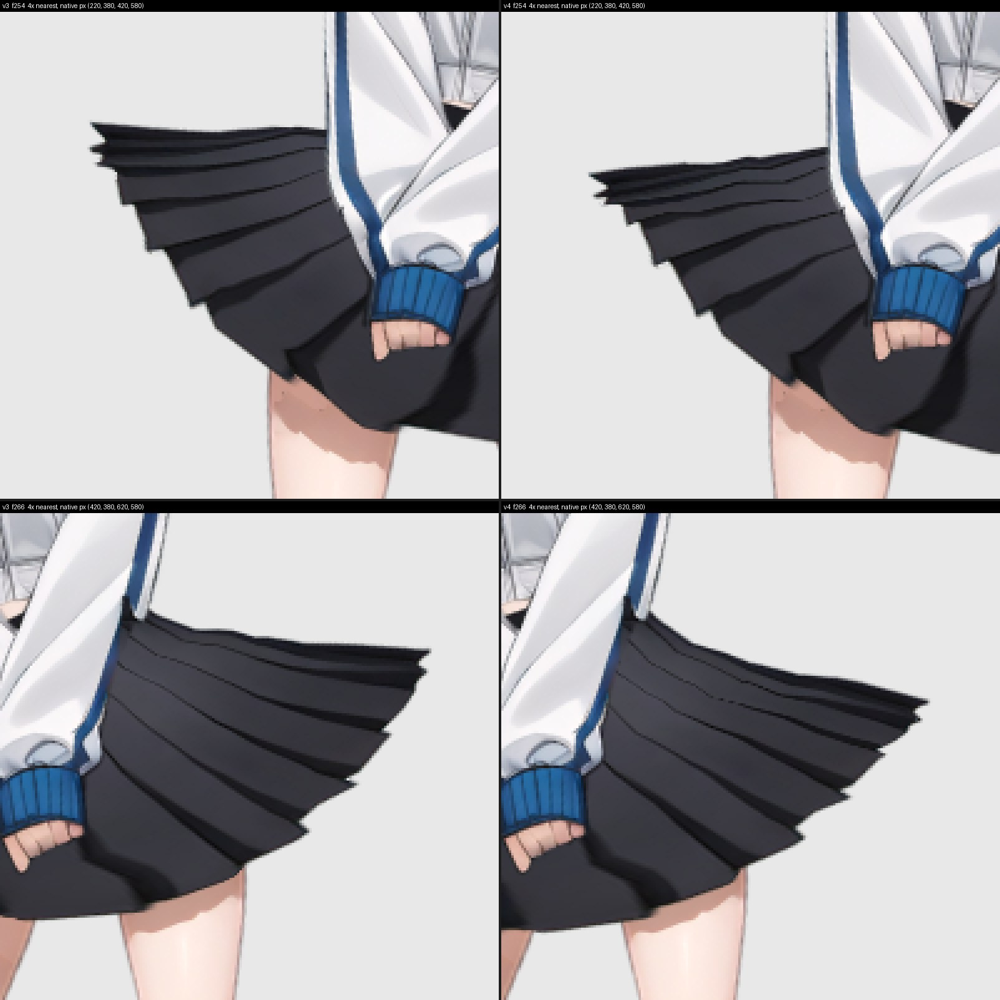

# Current accepted dance: v4, 2026-10-25

V4 replaces only `skins.default.bottomwear.bottomwear` in immutable v3 with the
owner-selected smear50 payload. Motion bytes, all other attachments, bones,
constraints, slots and skeleton remain identical. `provenance.json` binds the
sources and payload. The owner accepted v4 after video review: "v4 looks good,
merge it" ([#73](https://github.com/rig-c/examples/issues/73)). V4 is now the
default; v3 remains unchanged and selectable by name.

From `dancer/`, run the default replay (or select v4 explicitly):

```sh
sh build-accepted-dance.sh
sh build-accepted-dance.sh --version v4 work/accepted-v4
```

The frozen runtime installs from the dancer lockfile: released core 2.67.2,
Spine runtime 4.3.13. Python 3 and Bun are required. The real compile reader runs
before the build; the unchanged gate runs before render. A fresh output path is
required. Numbered PNGs are deleted after their ordered-byte receipt is written.
For staged measurement, `tools/reproduce-smear50.py` also supports `--build-only`,
`--render-only` and explicit `--keep-frames`. Measurement tools need retained
frames until the sheet/video verdict; delete them after recording the receipt.

The separate config producer uses parts 1.64.0 and its resolved core 2.70.0.
It is not the accepted dance rig and cannot consume its missing control bones.
These dance measurements apply only to this v4 replay.

| Original instrument / fixed viewport | V3 | V4 |
| --- | ---: | ---: |
| Left share >= .60, rounded to three decimals, original eval.py | 31 | 20 |
| Right share >= .60, same instrument | 13 | 4 |
| Bottomwear fold frames, all 391 samples | 0 | 0 |
| Known shins fold frames, reported separately | 269 | 269 |
| f254 left share | .860 | .745 |
| f266 right share | .799 | .671 |
| Worst minimum singular value, f278 | .119286 | .196432 |

These are a reduction, not elimination of the visible stair artifact. M1 tip
trajectory deviation is 0 units. Maximum silhouette deviation against accepted
v3 is 15.425046 pixels at f279, including 14.164224 pixels of setup shift. The
older 4.6-pixel figure used a different bind baseline and is not this comparison.

The gate reports 23 PASS, 0 FAIL, 13 SKIP, 14 excluded for each version. V3's three
compiled hashes and 391-frame native concatenation reproduce its accepted
record exactly. The new render receipts bind source/build hashes, commands,
viewport, geometry/folds and all ordered native PNG bytes in `evidence/`.
Original private measurement scripts remain outside this repository; their exact
hashes and actual outputs are recorded in `evidence/measurement.json`.



Owner review receives the f240–290 H.264 video privately: full figure plus both
flanks at 4x nearest, v3 left and v4 right; 3072x1600, 51 frames at 30 fps,
SAR 1:1, 1,367,689 bytes. The stream and SHA-256 are in the video receipt.
`tools/smear50-preview.py` reproduces that layout from retained v3/v4 frames;
provide Pillow and explicit ffmpeg/ffprobe executables. Original PNGs were
hash-checked and deleted after the sheet was read (391 per version). The small
sheet, video receipt and native render receipts remain. Owner eye acceptance is
recorded in #73; the measured receipts preserve their pre-verdict context.
