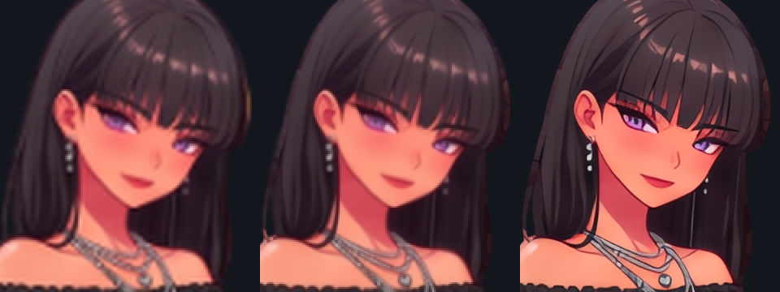
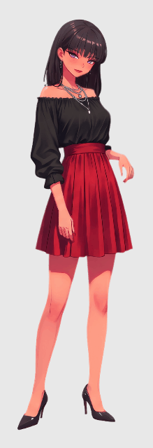
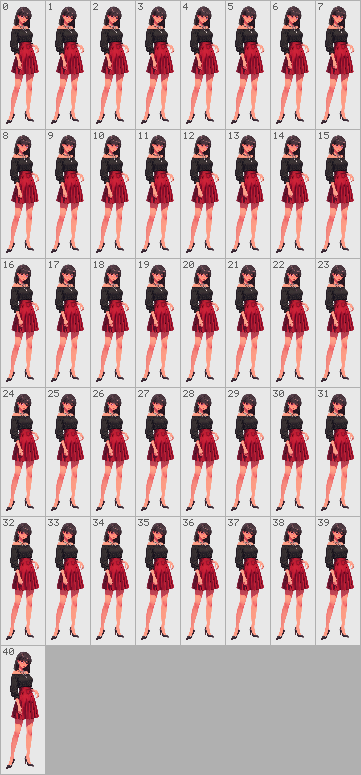
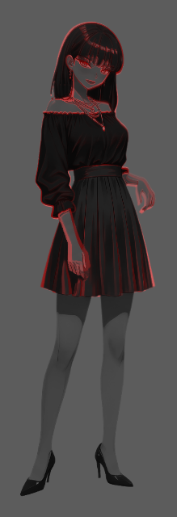
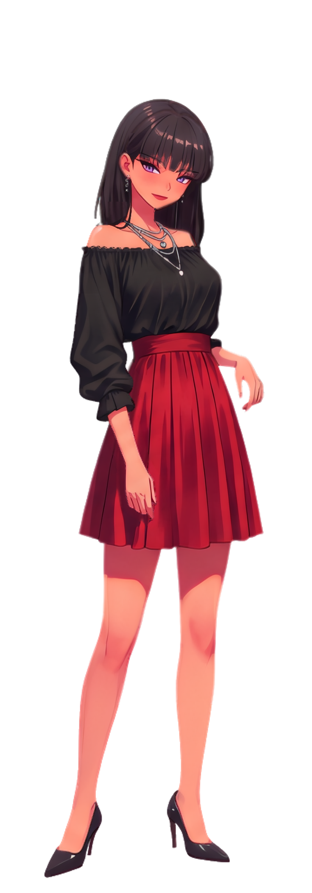
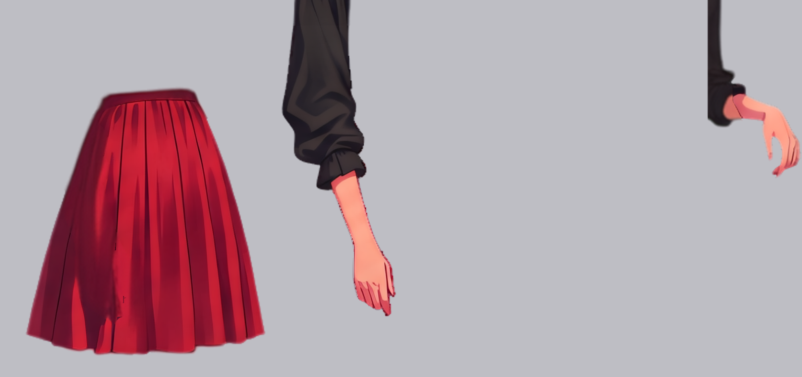
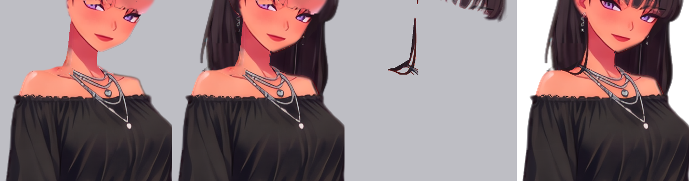
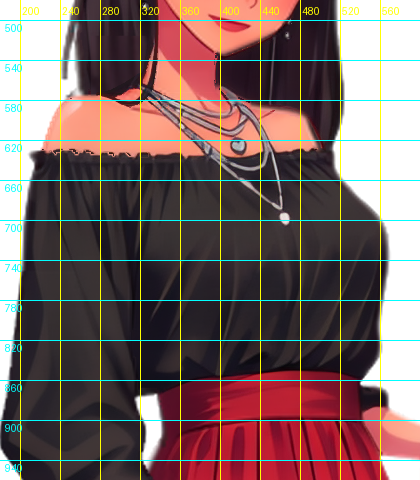
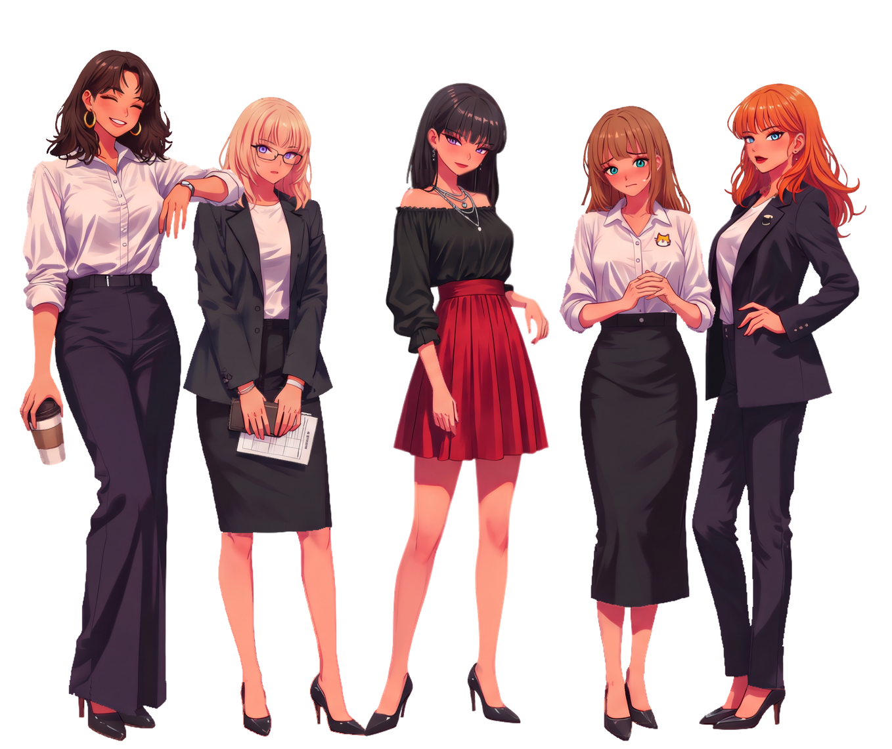

# Family — ComfyUI See-through 해상도 한계 극복 & 5인 그룹 Spine 리깅 데모

`family/`는 한 장의 와이드 그룹 일러스트(`1024×571` RGBA)를 `4x-AnimeSharp`로 고해상도(`4096×2284`) 업스케일한 뒤, **ComfyUI See-through (`jtydhr88/ComfyUI-See-through` / `layerdifforg/seethroughv0.0.2_layerdiff3d`)의 `1024×1024` 고정 해상도 한계를 극복**하여 5명의 캐릭터(`roa`, `luna`, `jinni`, `naru`, `nova`)를 개별 리깅하고 [`@rig-c/play`](https://github.com/rig-c/play)로 실시간 물리·합성 데모를 구동하는 실전 레퍼런스 예제입니다.

ComfyUI See-through가 제공하는 **우수한 은폐 영역(가려진 뒷머리·목·어깨·다리) 인페인팅**은 100% 원본 그대로 보존하면서, 전신 `2284px` 높이를 `1024×1024`에 우겨넣을 때 발생하는 해상도 저하를 **2-Pass (`full` 전신 + `head` 헤드 크롭) 분해**와 **가시 표면 `4x-AnimeSharp` 디테일 주입(`upgrade_*_4x.py`)**으로 해결한 전체 파이프라인 및 캐릭터별 바스트 탄성 베리에이션 설정을 포함하고 있습니다.

> 파이프라인(`@rig-c/parts` / `@rig-c/core` / `@rig-c/play`) 개선을 위한 상세 기술 제안은 [FEEDBACK.md](./FEEDBACK.md)에 별도로 정리되어 있습니다.

현재 Roa/Luna/Nova의 가슴 영역 및 Nova 바지 품질 교정은 [MESH_REGION_REPAIR.md](./MESH_REGION_REPAIR.md)의 마지막 authoring 단계를 따른다. 기존 `config.json`·upgrade 스크립트의 독립적인 재질 실험을 통째로 재빌드하지 않고, 고정된 머리 클리핑 입력을 재현한 뒤 가드된 attachment 교정을 적용하고 공식 build/check를 실행한다.

지니의 현재 마지막 단계는 [귀 뒤 옆머리 바인딩·깊이 교정](./jinni/BEHIND_EAR_STRAND.md)이다. 동결 원본 → 기존 윤곽·섬 클리핑 → `apply-jinni-behind-ear-strand.ts`의 가드된 교정 → 공식 build/check 순서로 재현한다. 앞머리 본을 따라 볼·목 앞으로 나오던 별도 가닥만 `head`에 고정하고 귀·얼굴 뒤, 어깨 앞에 배치해 원화의 말린 끝을 보존한다. 원화 픽셀과 나머지 앞머리·가슴·다른 캐릭터는 이 단계에서 바꾸지 않는다.

---

## 디렉토리 구조 (Layout)

```text
family/
├── README.md                                 # 본 문서 (See-through 해상도 한계 극복 워크플로, 스크립트 및 데모 안내)
├── FEEDBACK.md                               # @rig-c/parts · @rig-c/core · @rig-c/play 기술 피드백 문서
├── group_1024x571_rgba.png                   # 원본 5인 와이드 투명 배경 일러스트 (1024×571 RGBA)
├── group_2048x1142_rgba.png                  # 2x Lanczos 업스케일 중간본 (2048×1142 RGBA)
├── group_2048x1142_animesharp_rgba.png       # 2x AnimeSharp 다운샘플 비교본 (2048×1142 RGBA)
├── group_4096x2284_animesharp_rgba.png       # 최종 4x-AnimeSharp 업스케일 그룹 원화 (4096×2284 RGBA)
├── scripts/
│   ├── upgrade_roa_4x.py                     # #1 Roa 4x 레이어 정제 & config 생성 스크립트
│   ├── upgrade_luna_4x.py                    # #2 Luna 4x 레이어 정제 & config 생성 스크립트
│   ├── upgrade_jinni_4x.py                   # #3 Jinni 4x 레이어 정제 & config 생성 스크립트
│   ├── upgrade_naru_4x.py                    # #4 Naru 4x 레이어 정제 & config 생성 스크립트
│   └── upgrade_nova_4x.py                    # #5 Nova 4x 레이어 정제 & config 생성 스크립트
├── viewer/
│   ├── index.html                            # @rig-c/play 기반 인터랙티브 Spine WebGL + 5인 동시 물리 데모 뷰어
│   └── server.mjs                            # 로컬 확인용 정적 파일 서버 (기본 포트: 4568)
└── roa/ luna/ jinni/ naru/ nova/             # 5인 전원 (각 800×2284, 전원 check PASS 완료)
    ├── config.json                           # 4x 해상도(800×2284) 최종 rig-parts 설정 (물리·stops·가슴 탄성 베리에이션 포함)
    ├── inputs/
    │   ├── painting.png                      # 4x 크롭 원화 (800×2284 RGB, 흰색 매트)
    │   ├── painting_rgba.png                 # 4x 크롭 원화 (800×2284 RGBA)
    │   └── layers/
    │       ├── full_orig/                    # ComfyUI See-through 원본 전신 분해 결과 (1024×1024)
    │       ├── head_orig/                    # ComfyUI See-through 원본 헤드 분해 결과 (1024×1024)
    │       ├── full/                         # upgrade_*_4x.py가 정제·재구축한 전신 레이어 세트
    │       └── head/                         # upgrade_*_4x.py가 정제·재구축한 헤드 레이어 세트
    ├── out/                                  # rig-parts build 최종 산출물 (skeleton.json, skeleton.atlas, skeleton.png, idle.gif)
    └── docs/                                 # 정지 재합성(recomposite.png), 컨택트 시트(contact.png), 히트맵(motion_heat.png)
```

---

## 1. ComfyUI See-through 해상도 한계 극복 파이프라인

### 1.1 원본 그룹 이미지와 4x-AnimeSharp 업스케일
- **원본 (`group_1024x571_rgba.png`)**: 5명의 캐릭터가 나란히 서 있는 `1024×571` RGBA 이미지입니다. 개별 캐릭터의 폭이 약 `200px`에 불과해, 그대로 리깅하면 눈매·머리카락 결·손가락 디테일이 뭉개집니다.
- **4x 업스케일 (`group_4096x2284_animesharp_rgba.png`)**:
  - ComfyUI의 `4x-AnimeSharp.pth` 모델로 RGB 채널(검정 배경 매트)과 알파 마스크(3채널 그레이스케일 변환)를 각각 `4096×2284`로 업스케일하여 외곽선 수축률이 정확히 일치하도록 결합했습니다 (`alpha < 8` 미세 노이즈 클리핑).
  - 각 캐릭터를 `800×2284`로 크롭하여 `<char>/inputs/painting.png`로 사용합니다.



### 1.2 ComfyUI See-through (`1024×1024`) 은폐 영역 보존 + 가시 표면 4x 디테일 결합
- **See-through의 강점과 해상도 한계**:
  - ComfyUI See-through(`rig-parts comfy seethrough`, `layerdifforg/seethroughv0.0.2_layerdiff3d`)는 19개 시맨틱 레이어(`back hair`, `front hair`, `face`, `neck`, `topwear`, `bottomwear`, `legwear`, `footwear` 등)를 분리하면서 **앞 레이어에 가려진 뒷머리, 목기둥, 어깨/칼라, 다리 안쪽을 자연스럽게 인페인팅(복원)**해 줍니다.
  - 하지만 모델 추론 해상도가 **`1024×1024`로 고정**되어 있어, `800×2284` 전신을 정사각형 패딩(`2284×2284`) 후 `1024×1024`로 넣어 분해하면 전신 레이어(`full_orig`)의 실효 해상도가 원본 대비 약 `0.45배`(`358×1024`)로 낮아집니다.
- **해상도 한계 극복 전략 (`scripts/upgrade_*_4x.py`)**:
  1. **2-Pass 분해 (`full_orig` + `head_orig`)**: 얼굴·눈·눈썹·입·앞머리·뒷머리·목은 `head_box`(`440×440` ~ `530×530`) 영역만 크롭해 `1024×1024`로 분해(`head_orig`)함으로써 오히려 원본 4x보다 약 `2배` 높은 밀도로 정밀 분해합니다.
  2. **See-through 순정 인페인팅(숨겨진 영역) 100% 보존**: 물리 모션 시 노출되는 **가려진 영역(`back hair`의 얼굴/목 뒤쪽 인페인팅, `head_orig:topwear`의 머리카락 아래 어깨/칼라 인페인팅, `neck`의 옷깃 아래 언더턱)**은 인위적으로 도려내지 않고 See-through가 생성한 부드러운 인페인팅 픽셀을 그대로 보존합니다.
  3. **가시 표면(Visible Surface) 4x-AnimeSharp 주입**: 가려지지 않고 외부에 직접 노출되는 픽셀에만 `painting_rgba.png`(`800×2284`)의 선명한 4x RGB와 알파 외곽선을 가우시안 경계 블렌딩으로 주입하여, **정지 상태에서는 4x 원화의 칼같은 선명도를 유지하고 물리 모션 시에는 찢어짐이나 구멍 없이 See-through의 인페인팅 영역이 자연스럽게 드러나도록** 구성했습니다.

---

## 2. 리깅 설정 (`jinni/config.json`)

[`jinni/config.json`](./jinni/config.json)은 `800×2284` 캔버스 기준의 `rig-parts` 선언적 설정 파일입니다.

- **22개 파츠 (`parts`)**:
  - `head` 런에서 추출: `hair_back`, `ear_r`, `ear_l`, `neck`, `face`, `eye_r`, `eye_l`, `brow_r`, `brow_l`, `mouth`, `hair_front`
  - `full` 런에서 추출: `thigh_r`, `thigh_l`, `shin_r`, `shin_l`, `shoe_r`, `shoe_l`, `bottomwear`, `topwear`, `arm_r`, `arm_l`, `handwear_r`, `handwear_l`
- **스켈레톤 (`skeleton.points` & `chains`)**:
  - 중심 축: `hip` `[432, 1080]` → `waist` `[436, 868]` → `chest` `[442, 708]` → `neck` `[448, 560]` → `head` `[450, 480]` → `head_end` `[450, 210]`
  - 뒷머리 체인: `hairback_r` (3세그먼트), `hairback_l` (3세그먼트)
  - 치마 체인: `skirt_r`, `skirt_c`, `skirt_l` (각 2세그먼트)
  - **가슴 지글 본**: `chest` 하위에 좌우 독립 본 `boob_r` (`[384, 724]` → `[380, 756]`), `boob_l` (`[514, 720]` → `[518, 752]`) 배치
- **메시 (`meshes`)**:
  - `topwear`: `contour` 모드 + 좌우 가슴 원형 리파인먼트 영역(`bust_r`: `cx=384, cy=724, r=38, band=20`, `bust_l`: `cx=514, cy=720, r=46, band=24`)을 정의하여 몸통 외곽과 쇄골은 `chest`/`waist`에 고정하고 양쪽 가슴 볼륨만 독립적으로 탄성 변형되도록 구성
  - `hair_front`: 앞머리가 뒷머리 본에 끌려가지 않도록 `["head", "hairback_l"]`만 연결
- **물리(`physics`) & 각도 스톱(`stops`)**:
  - `hairback_r/l` (`chest` 기준 ±12°~18° 제한), `skirt_r/c/l` (`hip` 기준 ±8°~12° 제한)에 `stops`를 걸어 바람이나 드래그 시 치마가 허벅지를 파고들거나 머리카락이 어깨 살을 파고드는 현상 방지
  - `boob_r_phys`, `boob_l_phys`: `translateX=0.35`, `translateY=0.65`, `strength=55`, `damping=0.58`로 호흡 및 좌우 회전 시 자연스러운 2D 지글 구현

---

## 3. `rig-parts build` / `rigc build` 결과 (`jinni/out/`)

빌드 명령:

```bash
# family/ 디렉터리에서 실행합니다. Node.js, npm, Bun이 PATH에 필요합니다.
# 커밋된 정제 입력을 사용하므로 이 빌드 경로에는 Python이 필요하지 않습니다.
npm install --prefix .tools --no-audit --no-fund @rig-c/parts@1.25.0
./.tools/node_modules/.bin/rig-parts build --config jinni/config.json \
  --source jinni/inputs/painting.png \
  --full jinni/inputs/layers/full --head jinni/inputs/layers/head \
  --out jinni/out
```

정제 레이어와 config를 원본 `full_orig`·`head_orig`에서 다시 생성하려는 경우에만, Pillow·NumPy·SciPy가 설치된 별도 Python 환경에서 다음 선택 단계를 먼저 실행합니다. 위 빌드 명령은 저장된 정제 입력을 사용하며 이 Python 환경을 준비하지 않습니다.

```bash
python3 scripts/upgrade_jinni_4x.py
```

### 저장된 검증 지표 (11/11 PASS)

아래 수치와 `docs/` 이미지는 이 PR에 저장된 산출물의 기록입니다. 위 명령으로 재빌드한 결과는 `jinni/out/check/check.json`과 `jinni/out/check/gate_spine-html.txt`에서 별도로 확인합니다. 저장된 `ANIMATIONS_DO_NOT_FOLD` 측정은 물리 제약 24개를 제외한 `idle` 애니메이션을 검사했습니다(`physics_left_out: 24`). 이 표를 브라우저의 바람·드래그에 따른 실시간 물리 검증으로 해석하지 않습니다.

| 항목 | 수치 | 기준 | 결과 |
| :--- | :--- | :--- | :--- |
| `check` | **11 / 11 bar passed** | 전체 통과 | **PASS** |
| `loop` | **max \|d\| = 0** (`bone=hip.r`) | `<= 0.01` | **PASS** |
| `recomposite` | `corr=0.922`, `seam=0.056`, `out=0.000` | 외곽 누출 0 | **PASS** |
| `contact` | 6 poses (`wind`, `breath`, `sway`, `turn`, `nod`, `tilt`), `worst_tear=0.052` | 찢어짐 없음 | **PASS** |

````carousel

<!-- slide -->

<!-- slide -->

<!-- slide -->

````

---

## 4. 삽질 과정과 해결 스크립트 (`scripts/upgrade_jinni_4x.py`)

`1024×1024` See-through 레이어와 고해상도(`800×2284`) 4x 원화를 결합해 리깅하면서 발생한 **6가지 핵심 난제와 해결 기법**입니다. 모든 처리는 [`scripts/upgrade_jinni_4x.py`](./scripts/upgrade_jinni_4x.py)에 코드로 문서화되어 있으며 언제든 100% 재현됩니다.

### 삽질 1: 치마(`bottomwear`) 파츠에 오른손이 그대로 찍히는 문제
- **원인**:
  1. 1차 스크립트에서 4x 원화의 픽셀을 `bottomwear` 마스크 전체에 덮어씌우면서 치마 위에 겹쳐진 오른손(`handwear_r`) 픽셀까지 치마 레이어에 혼입됨.
  2. 설령 치마 레이어에서 손을 지우더라도, `rig-parts`의 `assemble.ts`가 실행하는 `projectSource()` 단계에서 `handwear-r`의 반투명 외곽(`alpha < 250`) 픽셀은 `pixelOwners` 코어로 인정받지 못해, 바로 아래에 깔린 불투명한 `bottomwear`(`alpha = 255`)가 원화의 검은 소매·손가락 테두리를 그대로 흡수(stamping)함.
- **해결**:
  - [`jinni/inputs/layers/full_orig/parts/bottomwear.png`](./jinni/inputs/layers/full_orig/parts/bottomwear.png)에 See-through가 인페인팅해 둔 **손 아래의 핑크색 대각선 치마 주름**을 `hwr_arm_zone` 영역에 복원하고 경계를 가우시안 블렌딩(`sigma=3.5`) 처리.
  - `layers.json` 순서상 `10 bottomwear` 위, `17 handwear-r` 아래에 위치한 미사용 레이어 **`12 full:neck` (`rank == -1`)**에 팔/손 모양의 불투명 마스크(`alpha = 255`)를 씌워 **`projectSource` 차폐 실드(shield)**로 활용. 이로써 `17 handwear-r`는 4x 원화 투영을 정상적으로 받으면서 `10 bottomwear`에는 손이 단 1픽셀도 찍히지 않음.
  - 추가로 `handwear_r` 손가락 끝의 반투명 픽셀에서 배경 치마 색상을 역산 제거(color decontamination)하고, `handwear_l`에 남아 있던 몸통 잔여물(`rx < 246`)을 클리닝.



### 삽질 2: 왼쪽 어깨(캐릭터 기준 오른쪽 맨어깨) 노이즈 및 소매 틈새
- **원인**:
  - `head:neck`의 어깨선이 `ry=315`에서 끝나는데 `full:topwear`의 상단 경계선이 너무 낮게(`ry=320`) 잘려 있어, 검은색 오프숄더 소매(`full:handwear-r`, `ry=315.5` 시작)와 맨어깨 사이에 빈 틈과 핑크/검정 경계 노이즈가 발생.
- **해결**:
  - `full:topwear`의 맨어깨 곡선(`shoulder_ctrl_rx_tw` / `shoulder_ctrl_ry_tw`)을 `ry=318.0`까지 매끄럽게 연장하여, 오프숄더 소매(`ry=315.5`) 아래로 2.5px 깊이만큼 자연스럽게 말려 들어가도록(under-tuck) 설계.

### 삽질 3: 목선 타고 내려온 머리카락 밑 바디 파츠(`neck` ↔ `topwear`) 구멍 & Lanczos3 링잉
- **원인**:
  1. 캐릭터 왼쪽 목선을 따라 쇄골까지 내려오는 짙은 갈색 머리카락 컬(`x=482..502, y=540..625`)이 `head:front hair`에서 누락되어, 그 아래 `neck`과 `topwear`에 검은 얼룩으로 찍힘.
  2. `head:neck` 하단(`y=584`)과 `full:topwear` 상단(`y=566`)이 만나는 경계에서, `full:topwear`의 `alpha == 0` 영역이 `[0, 0, 0, 0]`(검정)으로 비어 있다 보니 `assemble.ts`가 `1024 → 2284`로 **Lanczos3 업스케일**할 때 네거티브 로브(negative lobe) 오버슛이 발생함. 그 결과 `alpha >= 250` 시작점 첫 2줄의 RGB가 `[215, 81, 93]` 대신 `[230, 87, 100]`으로 하얗게 뜨고, `projectSource`의 `CORE_ERODE = 2px` 때문에 이 2줄이 원화로 덮어써지지 않아 가로 실금(구멍처럼 보이는 밝은 줄)이 남음.
- **해결**:
  - 쇄골 위 머리카락 가닥과 끝단 컬(`upper_strand_h | lower_curl_h`)을 색상 언믹싱(`unmix_fg`)으로 `head:front hair`에 온전히 편입하고, 미사용 레이어 `26 full:front hair`를 실드로 세워 `full:topwear`에 검은 머리카락이 찍히지 않게 보호.
  - `head:neck`을 순수 목 폭(`[true_neck_left_x_h, true_neck_right_x_h]`) 안으로만 제한하면서 아래(`ry=292.0`)까지 충분히 내리고, `full:topwear` 목 베이스 상단을 핑크색 목 그림자 아래(`ry=283.0`)에 배치.
  - **핵심**: `full:topwear`의 `alpha == 0` 투명 영역(`ry = 272..283`)에도 인접한 피부 RGB 색상을 미리 채워 넣어(RGB pre-fill) Lanczos3 업스케일 시 경계 오버슛/링잉을 0으로 제거.



### 삽질 4: 치마와 뒷머리 물리 관통 (살을 파고드는 현상)
- **원인**:
  - `meshes.hair_front.segments`에 `hairback_r`가 포함되어 있어 뒷머리가 흔들릴 때 얼굴 옆 앞머리까지 함께 꺾이며 볼과 목을 침범함.
  - 또한 `head:front hair` 텍스처 좌하단(귀 아래 `head_ry > 362`)에 뒷머리 픽셀이 섞여 있었고, 물리 체인에 각도 제한(`stops`)이 없었음.
- **해결**:
  - `head:front hair` 좌하단의 뒷머리 영역을 `head:back hair`로 이관하고, `meshes.hair_front.segments`에서 `"hairback_r"`를 제거.
  - `config.json`에 `stops` (`skirt_r/c/l` vs `hip`, `hairback_r/l` vs `chest`)를 추가하고 스프링 `strength`/`damping`을 높여 역방향 관통을 원천 차단.
  - [`viewer/index.html`](./viewer/index.html)에서 드래그 시 전달되는 `player.moved(dx, dy)` 임펄스를 프레임당 `[-14, 14]px`로 클램핑.

### 삽질 5: 3/4 뷰 양쪽 가슴 지글(`boob_r`, `boob_l`)과 캐릭터별 바스트 탄성 베리에이션
- **원인**:
  - `boob_r`/`boob_l`에 수동 `sineTrack`과 `PhysicsConstraint`를 중복 부여하거나, 낮은 `strength`에 과도한 `damping`(`>0.92`)/`gravity`를 결합하면 호흡 중 상시 흔들림 및 물풍선처럼 늘어지는 부작용 발생.
- **해결**:
  - `motion.tracks`에서 `boob_r`/`boob_l` 수동 트랙을 제거하여 순수 `PhysicsConstraint`로만 구동하고, 고강성(`strength = 278..480`) + 적정 속도 유지율(`damping = 0.85..0.89`) + 절제된 `inertia`(`0.30..0.47`) & `gravity`(`0.08..0.14`)로 튜닝하여 **느린 호흡 중에는 진폭 `< 0.23px`로 안정되고, 충격/드래그 시에는 2~2.5회 바운스(`0.45초` 이내) 후 제자리를 찾는 탱글탱글한 탄성**을 구현.
  - 캐릭터별 예상 바스트 볼륨에 따라 **무거운/가벼운 탄성 5단계 베리에이션**을 차등 적용:
    - **#1 Roa (Tier 5 · Max-Glamour)**: `r=26/28, band=42/44`, `strength=295/278, damping=0.89, inertia=0.44/0.47, mass=1.32/1.38, gravity=0.14` (1.5~2.0회 바운스)
    - **#3 Jinni (Tier 4 · Heavy-Glamour)**: `r=25/26, band=40/42`, `strength=330/315, damping=0.88, inertia=0.40/0.42, mass=1.22/1.26, gravity=0.12` (2.0회 바운스)
    - **#4 Naru (Tier 3 · Medium-Full)**: `r=24/24, band=38/38`, `strength=380/365, damping=0.87, inertia=0.36/0.38, mass=1.08/1.12, gravity=0.11` (2.0회 바운스)
    - **#5 Nova (Tier 2 · Medium-Firm)**: `r=23/23, band=37/37`, `strength=430/415, damping=0.86, inertia=0.32/0.34, mass=0.96/1.00, gravity=0.10` (2.5회 바운스)
    - **#2 Luna (Tier 1 · Light-Perky)**: `r=22/22, band=36/36`, `strength=480/465, damping=0.85, inertia=0.29/0.31, mass=0.84/0.86, gravity=0.08` (2.5회 바운스)



---

## 5. 에이전트 패밀리 5인 전원(`roa`, `luna`, `jinni`, `naru`, `nova`) 리깅 요약

| 순번 | 캐릭터 | 4x 크롭 구간 (`x`) | 그룹 합체 `offsetX` / `z` | 정제 스크립트 | `check` 결과 | 주요 리깅 및 피드백 반영 특징 |
| :---: | :--- | :---: | :---: | :--- | :---: | :--- |
| **#1** | **Roa (`roa`)** | `96..896` | `0` (`z=3`) | [`scripts/upgrade_roa_4x.py`](./scripts/upgrade_roa_4x.py) | **PASS (`10/10`)** | 왼팔을 루나(`luna`)의 오른쪽 어깨 위에 자연스럽게 걸치는 어깨동무 레이어링(`z=3 > z=2`), See-through 바지/신발 분리 보존, Tier 5 바스트 탄성 |
| **#2** | **Luna (`luna`)** | `896..1696` | `435` (`z=2`) | [`scripts/upgrade_luna_4x.py`](./scripts/upgrade_luna_4x.py) | **PASS (`10/10`)** | 로아의 왼팔 아래로 어깨가 맞물리는 배치(`offsetX=435, z=2`), 뒷머리/어깨 은폐 영역 보존, 재킷 밑자락(`hem_r/l`) 물리, Tier 1 바스트 탄성 |
| **#3** | **Jinni (`jinni`)** | `1688..2488` | `995` (`z=4`) | [`scripts/upgrade_jinni_4x.py`](./scripts/upgrade_jinni_4x.py) | **PASS (`11/11`)** | 센터 최전방(`z=4`) 배치, 오프숄더 니트 언더턱, 레드 플리츠 스커트 오른손 스탬핑 차폐(`12 full:neck` 실드), Tier 4 바스트 탄성 |
| **#4** | **Naru (`naru`)** | `2496..3296` | `1540` (`z=3`) | [`scripts/upgrade_naru_4x.py`](./scripts/upgrade_naru_4x.py) | **PASS (`10/10`)** | 지니 우측 밀착 배치(`offsetX=1540, z=3`), 손가락 4x 리페인팅 정제, 치마단 아래 다리 좌측 돌출 이미지 제거, Tier 3 바스트 탄성 |
| **#5** | **Nova (`nova`)** | `3296..4096` | `1915` (`z=2`) | [`scripts/upgrade_nova_4x.py`](./scripts/upgrade_nova_4x.py) | **PASS (`9/9`)** | 나루 우측 뒤편 밀착 배치(`offsetX=1915, z=2`), `head_orig:topwear` 어깨 인페인팅 결합 및 몸-머리 단차 제거, Tier 2 바스트 탄성 |



---

## 6. 라이브 뷰어 및 5인 밀착 합체 데모 (`viewer/`)

로컬 웹 서버를 띄워 브라우저에서 실시간 Spine WebGL 렌더링, 바람(`wind`), 마우스 드래그 물리 관성, **5인 전원 밀착 합체**를 바로 테스트할 수 있습니다.

```bash
node viewer/server.mjs
# Listening on http://localhost:4568
```

브라우저에서 `http://localhost:4568`을 열면 다음 기능을 사용할 수 있습니다:
- **캐릭터 및 합성 전환 (`#charSelect`)**:
  - **`합성 · 에이전트 패밀리 전원 (5인 밀착 합체)`**: 단일 거대 스켈레톤으로 병합하지 않고 5개의 독립 `RigPlayer` 인스턴스를 `offsetX` (`0, 435, 995, 1540, 1915`)와 `z-index` 깊이 레이어링(`3, 2, 4, 3, 2`)으로 밀착 배치하여, **로아의 왼팔이 루나의 오른쪽 어깨 위에 자연스럽게 얹히고 지니를 중심으로 5인이 어깨를 맞댄 패밀리 대형**을 실시간 동기화 구동
  - **`합성 · 로아 + 루나 (어깨동무 2인)`**: 로아(`offsetX=0, z=3`)와 루나(`offsetX=435, z=2`)의 어깨동무 호흡 동조 확인 모드
  - **`합성 · 원본 크롭 간격 (5인 분리 나열)`**: 원본 4x 크롭 간격(`0, 800, 1592, 2400, 3200`) 비교 모드
  - **비동기 독립 랜덤 눈 깜빡임**: `@rig-c/play`의 `adjust(pose)` 훅을 활용해 `idle` 루프에 구워진 주기적 블링크 대신 캐릭터별 독립 비주기 랜덤 타이머(`2.0~5.8s` 간격, 20% 확률 더블 블링크)와 호흡 위상 오프셋을 적용
  - `1번 · 로아 (Roa)` / `2번 · 루나 (Luna)` / `3번 · 지니 (Jinni)` / `4번 · 나루 (Naru)` / `5번 · 노바 (Nova)` 개별 검수 모드
- **실시간 물리 제어**:
  - `바람` / `산들바람`: `@rig-c/play`의 `player.environment({ wind: [w, 0], gravity: [0, g] })`를 통해 머리카락·치마/상의 밑자락·가슴 물리 체인에 실시간 풍력 인가
  - `찰랑이기` & **캔버스 드래그**: 캐릭터를 마우스로 잡고 흔들면 관성(`player.moved({ x, y })`)에 따라 머리카락, 의상, 가슴이 실시간 반응


