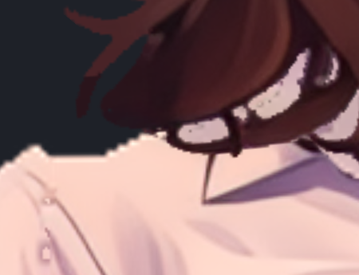
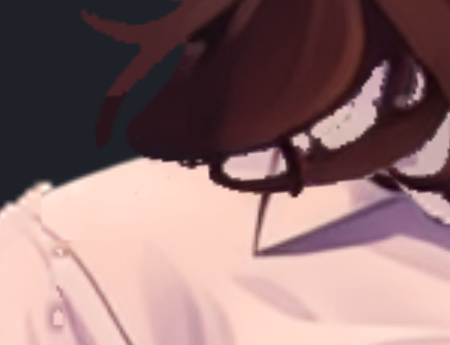
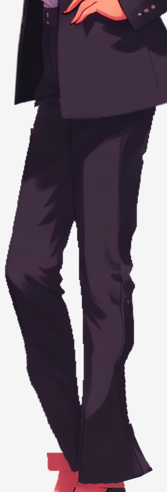
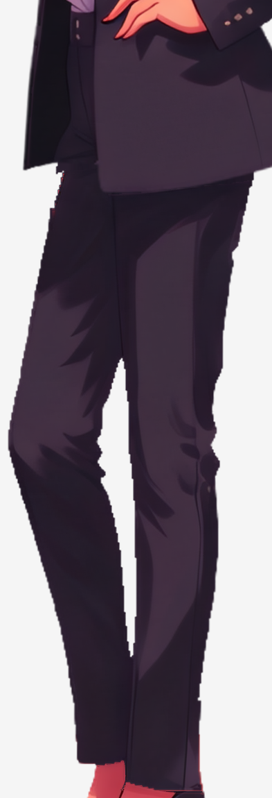

# Family: what a green rig still needed

The five-character Family demo combines See-through layers, higher-resolution
painting pixels, weighted meshes and live physics. A successful build still
left damaged silhouettes and incorrect motion. These repairs separate the
causes and keep their evidence beside the result.

## Naru: restore the edge before changing the renderer

The shoulder and sleeves looked stepped even though the atlas and player used
linear filtering. Matching part, rig-texture and atlas pixels located the
damage before rendering: alpha thresholding at 220, two-pixel erosion and a
1024-square binary mask for a 2284-pixel-tall figure. A rectangular cleanup
had also clipped the real shoulder out of the crop.

The repair restores narrow source-RGBA strips and the shoulder from the
unmodified group crop. At the forearm/cuff boundaries, that group image is
already an opaque composite: the replacement alpha is **inferred from source
RGB**, not a recovered separate matte. This edge repair generates no new
artwork. Only 61 exterior hull vertices move;
the existing bone weights, triangle indices and motion remain unchanged.

| Same calm frame, before | After |
| --- | --- |
|  |  |

[Source comparison, bounded recipe and measurements](naru/repairs/BODY_EDGE_RESTORATION.md).

## Roa: restoring alpha alone left a seam

When hair moved aside, the shoulder had a flat notch. An old guessed trim
line had deleted cloth alpha; the original See-through head-run layer still
contained the cloth. Restoring that alpha alone exposed a dotted white RGB
seam, so that candidate was rejected. The accepted repair blends the original
layer's RGB as well and expands five existing hull vertices to cover it.
This restores available layer content, not unknown original-painting pixels.

| Same gust96 frame 72, before | After |
| --- | --- |
|  |  |

[Source-backed shoulder restoration](roa/SHOULDER_REPAIR.md).

## Nova: source topology did not fix cuff physics

Restoring the original trousers mesh still left a motion defect: narrow cuffs
inverted under wind and exposed rectangular red texels beside the ankles.
Setting their physics mixes permanently to zero was refused by
`A23_PHYSICS_CONSTRAINT_EFFECTIVE`. The accepted repair removes the four cuff
physics declarations, retaining the small authored idle rotations. Images,
mesh topology, bindings and motion bytes remain unchanged.

| Same gust96 frame 50, before | After |
| --- | --- |
|  |  |

[Mesh restoration and cuff correction](MESH_REGION_REPAIR.md#nova-narrow-cuff-physics-correction).

## What was measured

These accepted repairs used parts 1.25.0, rig-c 2.57.0 and official
spine-core 4.3.13. Each passed its ordinary build and public parts check.
Additional paired runs include physics and compare native/core poses:

| Repair | Sampled conditions at 60 Hz | Result within that scope |
| --- | --- | --- |
| Naru edge | Calm, gust48 and gust96; 6 seconds each | No topwear folds; zero native/core vertex difference; protected collar/core/hand pixels unchanged |
| Roa shoulder | Calm, gust48 and gust96; 4 seconds each | No topwear folds; zero native/core vertex difference; no newly lost alpha-covered pixel centres |
| Nova cuffs | Calm, constant ±48/±96, gust48/96 and constant ±200; 12 seconds each | No bottomwear inversions; zero native/core vertex difference; non-cuff bones and non-bottomwear attachments unchanged |

The public check's keyed-loop and fold measurements exclude physics; they
cannot replace these paired runs. Naru's packed official build measured 27
assertions and skipped 23 inapplicable ones. Roa's parts check measured 10 of
11 bars and skipped `BLINK_NO_HOLE`. These samples do not certify every Spine
feature or arbitrary animation. Naru's edge repair did not measure gust200 or
physical-device rendering. Whole-source recomposite reports remain separate
from the bounded repairs' acceptance.

## A completion is different from a restoration

Naru's [rearhair completion](naru/BACKHAIR_REGENERATION.md) replaces a cut
underside and skin-coloured smudges with **new generated artwork**. Visible
hair pixels also change; it is not source-pixel recovery. The accepted hair
has zero inversions in the measured calm/48/96 gust runs, but the documented
±200 stress schedules still reach 6/4 inverted triangles, contributing up to
52/3 render pixels above an RGB-difference threshold of 8. A candidate with
fewer extreme folds was rejected because it introduced a visible fold. The
source-fidelity statistics remain reports, not proof of original-art identity.

Other repairs include [Jinni's behind-ear strand binding and depth](jinni/BEHIND_EAR_STRAND.md)
and the [authored chest deformation fields](MESH_REGION_REPAIR.md). The
[feedback record](FEEDBACK.md) preserves corrected hypotheses separately from
established causes.

## Replay and inspect

For the current final assets across all 15 rigs (5 characters × 3 outfits: `office`, `homewear`, `swimwear`), use the [canonical accepted-input and reproducibility verification commands](README.md#현재-승인된-입력과-재검증). `verify-reproducibility.mjs` and `verify-accepted.mjs` rebuild each rig from its canonical `config.json` and hash-pinned `declared-repairs.json` (`x-repairs`) into fresh output directories, verifying `rig.json`, the 294-row `mesh_report.json` `v/t` table, and compiled `skeleton.model.json` before running the full `rig-parts check`. This verifies the current deterministic authoring closure; it is not a replay from image generation through every historical repair.

The individual historical repair recipes above require their own stage preimages, which differ from today's final outputs after subsequent bust calibration and upper/forearm splits. Investigate those historical stages in separate directories with the exact prerequisite inputs; do not run old one-off recipes over the current `out/`. The transforms refuse changed preimages and emit no Spine artifacts. Regenerating a policy to silence a refusal would discard its guard.

For the current composition, run `node family/viewer/server.mjs` from the repository root and open `http://localhost:4568`. The [viewer guide](README.md#6-라이브-뷰어-및-5인-밀착-합체-데모-viewer) covers characters, the 5-character group, 3-outfit switching (`office` / `homewear` / `swimwear`), interactive bust-region editing, wind and dragging. Live interaction complements the matched captures; a wall-clock browser capture is not a paired pose measurement.
