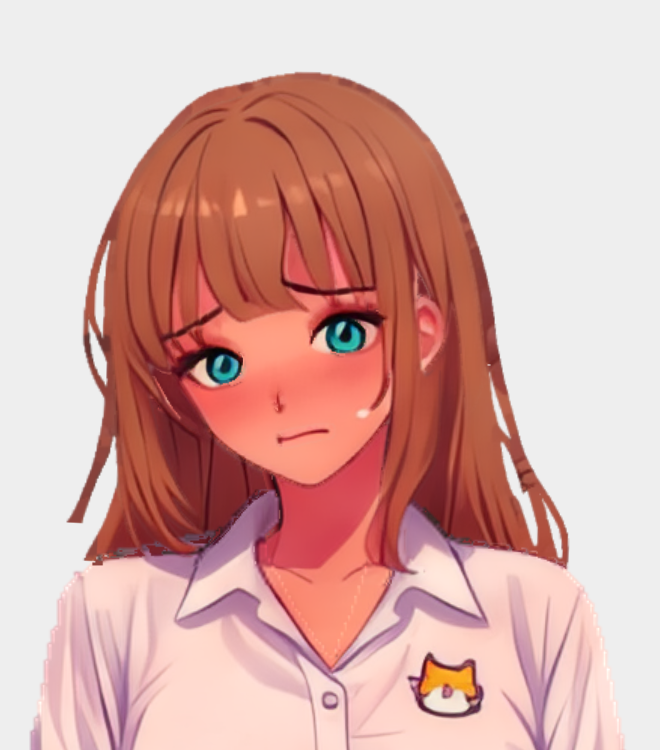
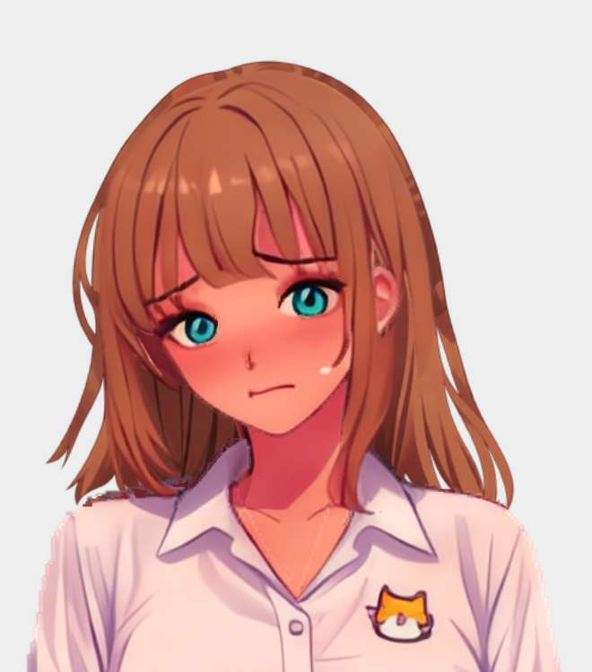
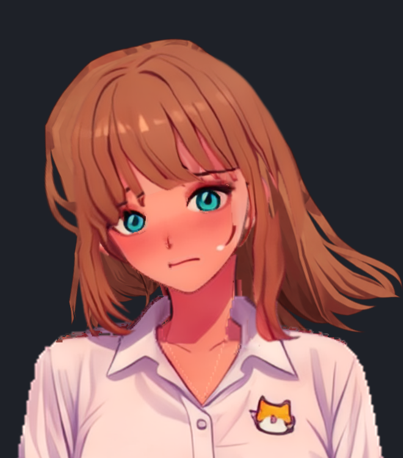
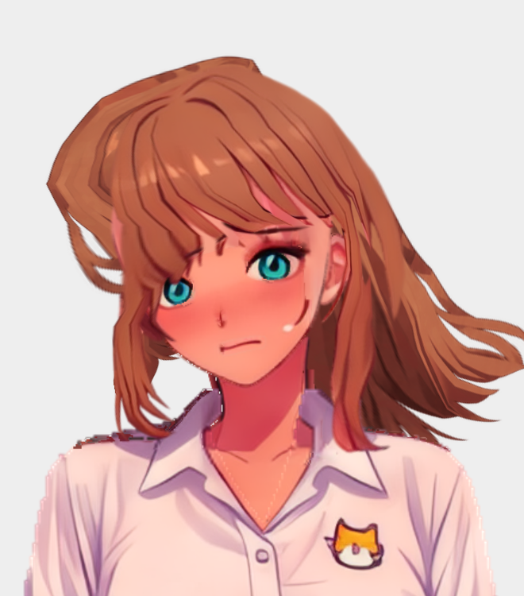

# Generated hidden rearhair completion

Naru's rearhair PNG ended along the shirt's occlusion line. The two narrow screen-right strand gaps are present in the original painting and are intentionally retained. Independent diagnosis found no missing texture coverage in the old mesh: the cut was raster authoring, not omitted geometry. Restoring the whole old See-through layer was rejected because its hidden centre/lower extension contained skin-coloured smudges.

The selected built-in image-generation edit completes the hidden centre with auburn strands and finishes the lower lobes in separate tapered ends. It is **new generated artwork**, not recovery of unknown source pixels. Existing visible hair pixels and the outline also changed; exact pixel preservation is not claimed. The original painting, See-through inputs and other parts remain unchanged. The historical README's 100% hidden-pixel-preservation description does not describe this explicit final stage.

`repairs/backhair-generated-1254.png` retains the untouched tool output. The explicitly authorized deterministic resize produced `backhair-generated-440.png` with Pillow LANCZOS, uniformly 1254→440, without crop, translation, painting or alpha-threshold deletion. The part occupies source `[160,300,600,740]` on the 800×2284 canvas; the existing head anchor stays `[380,575]`. Public parts 1.25 adds its normal 4 px transparent pad, producing the 448×448 rig texture. Prompts, resize method and hashes are beside the images.

## Authoring and replay

The accepted public parts 1.25 contour is 80 vertices and 99 triangles, hull 59, tolerance 4, margin 4, spacing 52, maxEdge 52, radius 15 and the original seven head/hairback segment bones. It uses the public bridges/faint policy; three isolated pixels at alpha 9 are reported as faint. Main art 81094 pixels is covered. The report's whole-source coverage is 0.99996, not an all-alpha 100% assertion. Minimum angle is 13.025101° and maximum edge ratio 4.413928, versus 9.451378° and 5.774182 before. No full rectangular lattice is substituted for the contour.

The frozen payload was produced by `@rig-c/parts@1.25.0` `buildRig`, using only the hair-back mesh settings and matching existing bind frames, then extracted into the accepted full authoring rig. No generated bones, constraints, motion, other attachments, dirty material configs or upgrade-script output was adopted. All non-target authoring fields, image bytes and motion bytes are checked against their accepted inputs. `backhair-regeneration.source.json` is the exact accepted result of the preceding frozen outline-field clipping stage; it carries the existing front-hair/skirt field and chest physics. The old input texture/parts records/report are retained solely to make this final stage replayable after the current output is replaced.

From `family/`, prepare fresh input directories using the unchanged current non-target assets and the frozen old target:

```sh
WORK=/absolute/path/to/new-naru-backhair-replay
mkdir -p "$WORK/source-rig" "$WORK/source-parts/parts"
cp naru/backhair-regeneration.source.json "$WORK/source-rig/rig.json"
cp naru/repairs/backhair-input-mesh-report.json "$WORK/source-rig/mesh_report.json"
cp naru/out/rig/motion.json "$WORK/source-rig/motion.json"
cp -R naru/out/rig/images "$WORK/source-rig/images"
cp naru/repairs/backhair-input-rig.png "$WORK/source-rig/images/hair_back.png"
cp -R naru/out/parts/. "$WORK/source-parts/parts/"
cp naru/repairs/backhair-input-part.png "$WORK/source-parts/parts/hair_back.png"
cp naru/repairs/backhair-input-parts.json "$WORK/source-parts/parts.json"
bun tools/apply-naru-backhair-regeneration.ts \
  --source-rig-dir "$WORK/source-rig" --source-parts-dir "$WORK/source-parts" \
  --out-rig-dir "$WORK/final-rig" --out-parts-dir "$WORK/final-parts" \
  --policy naru/backhair-regeneration.json
```

The transform refuses an occupied output, changed source rig, motion, mesh report, any rig/part PNG, parts manifest, generated asset or payload. It replaces only `hair_back`, its mesh-report row, its part record/PNG and the publicly remeasured recomposite statistics. It emits no Spine artifact and does not certify its own output. With the exact tools in `tools/outline-field-clip/package.json` installed from the frozen lock, run the normal gates:

```sh
TOOLS=tools/outline-field-clip/node_modules/.bin
"$TOOLS/rigc" build --rig "$WORK/final-rig/rig.json" \
  --motion "$WORK/final-rig/motion.json" --out "$WORK/build" \
  --profile rig-play --pack --page-edges free --pack-shape polygon
"$TOOLS/rig-parts" check --rig "$WORK/final-rig" --parts "$WORK/final-parts" \
  --out "$WORK/check" --page-edges free --pack-shape polygon --seam-pairs
```

Replaying from a different upstream clip or later non-target asset revision requires a separately reviewed policy; do not regenerate one automatically to silence the preimage refusal. Running `upgrade_naru_4x.py` or rebuilding the dirty material config is not this recipe and can reinstate the cut.

## Measured acceptance and remaining stress behaviour

Pinned parts 1.25.0, rig-c 2.57.0 and official Spine 4.3.13 build passes, and public parts check measures 10/10 bars and passes. Matching 12-second 60 Hz calm,48 gust and 96 gust walks have zero rearhair inversions. Native/core vertex delta, every bone matrix and every non-rearhair attachment delta are 0 throughout the measured walks, including the existing front hair, skirt and chest. The rearhair's existing physics declarations and stops are unchanged. Dark/light matched renders show completed brown undersides without the skin ghost and retain both original screen-right gaps.

The ±200 stress schedules are 24 seconds at 60 Hz, base ±100 plus a 200 peak 20-second normalized gust. They remain outside that zero-fold result: the accepted contour reaches 6 and 4 inverted triangles, respectively. Positive stress has up to 52 render pixels with RGB contribution above 8 from an inverted left-tip triangle (80.873 rig px² maximum inverse area); the largest 744.791 rig px² central inversion is fully hidden. Negative stress reaches 3 pixels above 8. Pixel figures use 1.5 render pixels per rig pixel and compare the full composition against the same frame with just the folded triangle omitted, over every folded triangle in every sampled frame. This stage does not solve arbitrary-force hair behaviour or claim all folds are 0. The existing controls are not clamped to conceal these observations.

A narrow head/tip weighting region was rejected because it introduced visible folds in 48/96 gusts. A broad smooth head region reduced the extreme fold count to 1/1 but introduced a visibly contributing negative-stress fold; it too was rejected. The accepted original-distance contour retains the intended normal hair motion instead of chasing a smaller stress count.

The new visible artwork also differs from the source painting. Public recomposite statistics were remeasured rather than copied: mean absolute RGB difference 1.091,16312 error pixels,5759 uncovered-error pixels and 555 holes. These remain `REPORTED`, not a source-fidelity pass; public check's 10/10 bar result does not certify original-art identity. Its ordinary animation-fold bar excludes physics, so the separate live-physics measurements above are required.

| Accepted old cut | Generated complete underside |
| --- | --- |
|  |  |





Raw measurements, guard controls, input/output hashes and run identifiers: `backhair-regeneration.measurements.json`. Official gate/check output remains in `out/check/`. Browser captures are wall-clock UI observations, separate from the same-phase native/runtime proof.
