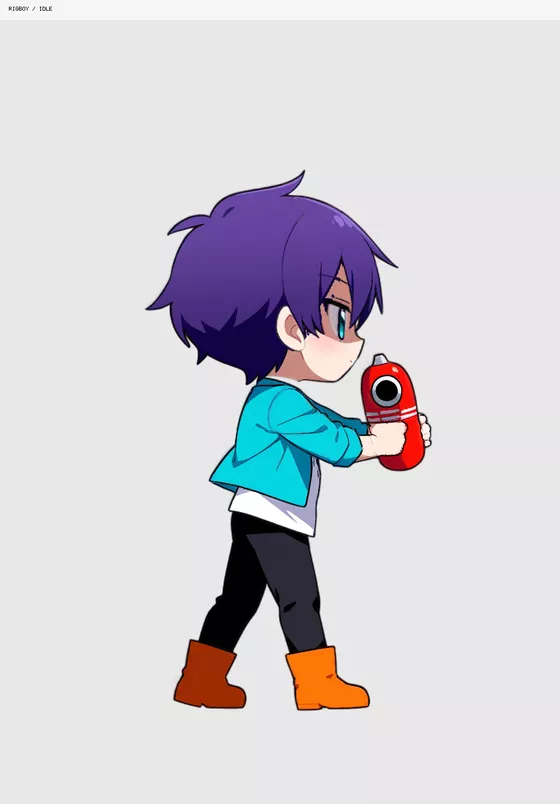

# rigboy



The first SD-style motion character rig in the rig-c examples: an original short-haired boy in a jacket, trousers and orange boots, in full side profile with a two-handed sci-fi toy grip. It takes the motion-demo role of Spineboy, with original artwork and authoring; no benchmark art, rig data or coordinates were copied.

| Sample | What it demonstrates |
| --- | --- |
| `idle` | Translated chest breath, gentle head motion and fringe physics |
| `walk` | A modest keyed contact/passing loop with separate, level feet |
| `run` | A faster, modest keyed loop with shorter support and airborne intervals |
| `jump` | Anticipation, air and landing |
| `aim` | A live dial over −8° to +8° around the painted upward toy pose |
| `shoot` | Modest arm recoil and spring settling |
| `hit` | A small flinch and return |

The `aim` animation stores the dial's pose range. The `aim_dial` slider reads `aim_control.rotate`; interaction drives that property instead of autoplaying the range. Toy world angles are approximately 82°, 90° and 98° at the dial's endpoints and center. Both hands stay with the toy. The hidden far upper arm has no artwork for an independent gesture. `look` is omitted because this profile does not supply the hidden facial side.

## Play

Pins: `@rig-c/parts@1.79.1`, `@rig-c/core@2.81.1` (the `rigc` CLI), and `@rig-c/play@1.21.2`.

Serve this repository over HTTP. From an application page at the repository root, with the player package available to your module loader:

```js
import { loadModel, RigPlayer } from '@rig-c/play';
import { rigboyControls } from './rigboy/controls.js';

const assets = await loadModel({
  modelUrl: new URL('./rigboy/build/skeleton.model.json', document.baseURI).href,
  setsUrl: null,
  regions: 'data',
});
// The loader resolves skeleton.png relative to the model URL.
// No separate atlas URL or attachment-sets file is needed.
const root = document.getElementById('rigboy'); // a positioned world origin, Y-up
const player = new RigPlayer(root, assets, { mode: 'dom', meshBackend: 'canvas2d' });
player.play('idle');
const controls = rigboyControls(player);
player.renderer.syncPixelRatio(); // call again after changing the root's display scale

let last = performance.now();
let frameId = requestAnimationFrame(function tick(now) {
  player.frame((now - last) / 1000);
  last = now;
  frameId = requestAnimationFrame(tick);
});

// UI examples; invoke these when the user selects a control or clip:
// controls.setAimDegrees(4); // finite values clamp to −8°..+8°
// controls.aimAt([worldX, worldY]); // Y-up; returns requested/applied/clamped
// player.play('walk'); controls.setAimDegrees(0); controls.setTravel(true);
// player.play('shoot', { loop: false }); controls.setTravel(false);
// controls.setAimDegrees(0); controls.recoilPhysics(); // restore the authored arm spring

function unload() {
  cancelAnimationFrame(frameId);
  controls.dispose();
  player.dispose();
  assets.dispose();
}
```

The app lays out and scales the root element. Walk and run are **in-place** cycles: stance feet move backward relative to the body. `controls.setTravel(true)` adds root advance using unwrapped track time (64 rig pixels/s for walk, 192 for run); that helper was used for world contact checks. The model alone does not plant feet in an application's world. Disable travel for stationary clips; the application owns movement, collisions and camera. `aimAt` reports clamping outside the narrow arc and refuses targets inside its geometric reach. `setAimDegrees` disables arm settling for direct aim; `recoilPhysics` restores it for shooting.

## Files and reproduction

[`generation.json`](generation.json) records the exact selected painting, prompts, seed, checkpoint and See-through settings. [`generation/graph.json`](generation/graph.json), its adjacent `control.png` and `pose.json` preserve the selected synthetic profile conditioning. `painting.png`, `inputs/` and `layers/` retain the source and both layer runs, including depth files. `assembled/` holds the structural pieces and their per-piece provenance; `config.json` and `motions.json` author the rig. `rig/` is the generated rig/motion/image set and `build/` the packed model, atlas and page.

With the pinned packages installed, run from the repository root:

```sh
rig-parts rig --config rigboy/config.json --parts rigboy/assembled --out rigboy/rig --idle-keys direct
rigc build --rig rigboy/rig/rig.json --motion rigboy/rig/motion.json --out rigboy/build --profile rig-play --pack --page-edges free --pack-shape polygon
rig-parts check --rig rigboy/rig --parts rigboy/assembled --source rigboy/painting.png --requirements rigboy/requirements.json --out rigboy/check
```

The preview is a labeled loop montage; live aim is a property-driven control. Physics is stepped during playback, so keyed loop closure does not promise exact physics-state closure.

## Measured limits

This v1 keeps modest amplitudes within the tested full-profile range. The retained scoped check passed with 8/12 checks measured and 4 skipped (blink, idle lag chain, held arm/hand swing, stress chain). Sampled folds and native boundary review support that range, not pixel-perfect source fidelity or unseen-side motion. For this source and tested workflow, deeper gait needs artwork initially drawn as separate parts; this is not a universal side-profile limitation. See [issue #78](https://github.com/rig-c/examples/issues/78).

## Terms and credits

Painted with **Hassaku XL (Illustrious) v1.3 Style A by Ikena** ([publisher](https://civitai.com/models/140272?modelVersionId=1240288)), Fair AI Public License 1.0-SD, as recorded in the source provenance. No LoRA, existing-character prompt/reference, hand detailer or painted fill was used. Structural garment separations and automatic assembly operations are recorded in `assembled/parts.json`; the result is not claimed to be an unchanged copy of every raw layer.

The repository's [MIT licence](../LICENSE) and the checkpoint publisher's own terms concern their respective material. A package's MIT licence is not a licence grant for the checkpoint. The checkpoint and See-through implementation are not redistributed here.
