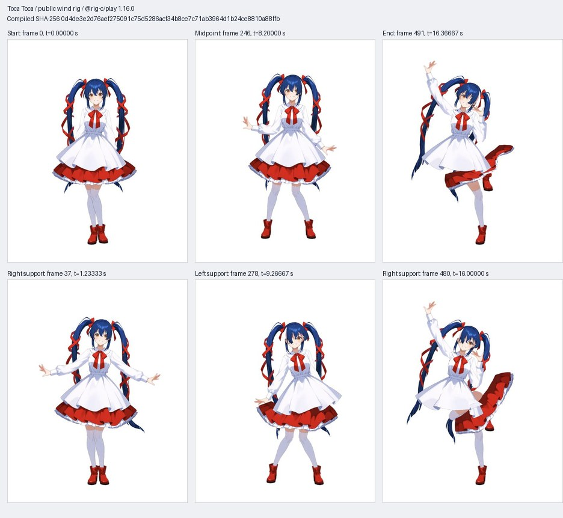

# 2026-10-23 toca-toca: fresh pose to the existing wind rig

## Question

Does `rig-pose` 1.0.1 retarget a fresh Toca Toca acquisition to the existing
public wind rig with LAND green and measured planted feet, and does the same
compiled generation play in `@rig-c/play` before an owner hand pass?

## Inputs

| Input | Where it came from | Origin | Committed here? |
| --- | --- | --- | --- |
| Toca Toca original | a YouTube Shorts video (link withheld); creator not identified | YouTube Shorts video (link withheld) | No: video, audio and reference pixels withheld |
| Fresh body-18 joint data | `acquisition/run.sh`, reviewed external RTMPose acquisition | Generated by this trial | Yes: `acquisition/pose.json` |
| Cleaned sequence | `rig-pose clean` on that fresh acquisition | Generated by this trial | Yes: `cleanedpose.json` |
| Wind painting and layers | [wind/ at corpus 723d5ed](https://github.com/rig-c/examples/tree/723d5ed57185bf3835b939c02507d0bae00d64f6/wind); `corpus-inputs.json` lists all 65 paths, blob IDs and SHA-256 digests | Corpus | Fetched by pin; corpus unchanged |
| Existing wind configuration and control pose | [parts examples/wind at 6f4e804](https://github.com/rig-c/parts/tree/6f4e8040d5a4861462b6be20933a4d7c85dac01f/examples/wind) | Public parts source | Yes: exact `rig-config/config.json` and adjacent `rig-config/pose.json` |
| Joint map | `map.json`, resolved against the canonical built bones | Generated by this trial; no new rig | Yes |
| Detector and whole-body checkpoint | Public OpenMMLab model URLs and file hashes in `acquisition/pins.json` | OpenMMLab | No: model binaries; names, versions, URLs and hashes committed |

Withheld: original/re-encoded reference videos, audio, reference pixels,
whole-body 133-point raw diagnostic data and detailed private logs. Only
processed joint data and public-rig captures enter this directory. No old pose
frames were reused. Original identity: 1080 × 1920, 30 fps, 492 decoded frames;
source duration 16.421 s. The earlier copied source label was stale; this fresh
acquisition identifies its source video. Creator not identified.

The raw video SHA-256 is
`f6cef60e5d3b119d515ecc00a876c6133551dd59a089fb50fb69801b719329e8`.
The withheld whole-body JSON SHA-256 is
`edd6c72a19a4f630a5d9115ff2cf122a8d22003a27c1e10d3ae0eb9ffb9d1c94`;
`acquisition/run.sh` below reproduces it as `raw_wholebody.json`.

`rig-config/pose.json` is the existing wind generation control pose named by
`config.generation.control.skeleton`, not the dance sequence. Both saved
configuration files are used without edits. The existing rig has independent
`leg_r0 → leg_r1 → foot_r` and `leg_l0 → leg_l1 → foot_l` chains, and free arm
chains `sleeve_r0 → sleeve_r1` and `sleeve_l0 → sleeve_l1`. The config's declared
arm/leg cuts and the canonical built bone names establish this mapping:

| Map chain | Existing bones | Body-18 joints / rig aim |
| --- | --- | --- |
| pelvis | hip | r_hip → l_hip / leg_r0 → leg_l0 |
| trunk | chest | mid_hip → neck / neck |
| head | head | r_eye → l_eye / eye_r → eye_l |
| arm_r, arm_l | sleeve_r0/r1, sleeve_l0/l1 | shoulder → elbow → wrist on each side |
| leg_r, leg_l | leg_r0/r1, leg_l0/l1 | hip → knee → ankle on each side |
| translation | hip | mid_hip; scale mid_hip → neck against hip → neck |

Body-18 has no toe joints. Existing feet retain `noRotationOrReflection`;
there are no fabricated toe mappings, new drawings, chain ranges or rig edits.
Arm/leg map chains use the documented `bend: free`: canonical front-view knees
have setup bends about 0.179268° / 0.278852°, below the default 0.5° hinge-rest
requirement. This does not certify anatomical knee or elbow direction.

## Commands and pins

| Tool or source | Exact version or commit |
| --- | --- |
| @rig-c/pose | 1.0.1; source 6187ed7af25184d10782bf29a8f123061f5496a8 |
| rig-c | 2.67.2; source 3b351edf72687b9ef90f5b70dc2cb9de2ba6c4d3 |
| @rig-c/parts | 1.60.0; source 6f4e8040d5a4861462b6be20933a4d7c85dac01f |
| @rig-c/play | 1.16.0; source 549d90bb3474113d72eab35c3bce0d02822f0085 |
| Official development round-trip runtime | @esotericsoftware/spine-core 4.3.13 |
| Bun / Node / Python | 1.4.2 / 24.21.0 / 3.12.3 |
| External acquisition | rtmlib 0.0.16, onnxruntime 1.31.0, CPUExecutionProvider only; remaining exact versions and wheel hashes in `acquisition/requirements.lock` |
| Existing balanced models | YOLOX-M `yolox_m_8xb8-300e_humanart-c2c7a14a.onnx`; RTMW `rtmw-dw-x-l_simcc-cocktail14_270e-256x192_20231122.onnx`; exact SHA-256/input dimensions in `acquisition/pins.json` |
| Corpus input pin | 723d5ed57185bf3835b939c02507d0bae00d64f6 |
| Initial authoring baseline | 1ece5ddb5ce5b8333fbda65961d845672c69d16c (PR35); distinct from corpus pin |
| README/TEMPLATE convention read | origin main 5e082dfa5d765d4541c06087021e0a74ba67aa34 |

From this trial directory, supply the withheld original separately. Acquisition
is an external input-producing step, **not** a shipped `rig-pose scan` command.
The three-frame precheck ran before the fresh full acquisition; both exited 0:

```sh
sh acquisition/run.sh --video withheld/orig.webm --models withheld/models --out work/precheck --frames 0,246,491
sh acquisition/run.sh --video withheld/orig.webm --models withheld/models --out work/acquisition
```

The verified raw body-18 output is committed verbatim as `acquisition/pose.json`
(SHA-256 `b862bb09226c7b294b006f2bde6a799bab1f80b84fb432361e43e7df6a95de96`).
Its `rig-c-pose-frames/0` format is accepted directly by clean 1.0.1; **no
conversion was needed** and no detector coordinates were silently rewritten.
The toolchain starts at clean. A 30-frame clean/retarget precheck exited 0
before the full 492-frame run.

Reproduce from the committed raw acquisition without repeating inference:

```sh
sh reproduce.sh
# Optional actual UI, after reproduction:
python3 -m http.server 8763 --bind 127.0.0.1 --directory work/site
```

`reproduce.py` executes these pinned CLI commands, sequentially, exactly as
in the public-input reproduction (after `python3 fetch-inputs.py --out
work/corpus` and `bun install` in `work/runtime` with the supplied package pins):

```sh
bun --bun run work/runtime/node_modules/.bin/rig-parts build --config rig-config/config.json --source work/corpus/wind/painting.png --full work/corpus/wind/layers/full --head work/corpus/wind/layers/head --out work/wind
bun --bun run work/runtime/node_modules/.bin/rig-pose clean --pose acquisition/pose.json --out work/cleanedpose.json --legs 5 --rest 7
bun --bun run work/runtime/node_modules/.bin/rig-pose retarget --rig work/wind/rig --map map.json --sequence work/cleanedpose.json --out work/motion.json --animation toca-toca --plant-feet --profile spine-html --parts work/wind/parts.json --reference withheld/orig.webm --report work/report.json --build work/build
```

`spine-html` is the pose CLI's accepted profile name; the actual gate reports
`rig-play`. Clean uses its documented 5/7 windows and remaining defaults.
No `--flip`, `--short`, `--leg-scale`, `--stance`, reduction, idle carry or
manual contact keys were added. The run used the shared Nova pool with
6 GiB / four-worker guards, not a full test suite. `TRIAL_GUARD` optionally
names the caller's per-command guard; no machine path is embedded.

`play.html` loads the locally installed pinned player module, verifies the
compiled JSON hash, and supplies the six capture controls. Actual Chrome/CUA
screenshots were composed with Pillow APIs (the capture
compositor is not a motion metric):

```sh
python3 contact-sheet.py --captures work/browser-captures --out contact-sheet.jpg
```

## Measurement

Acquisition bars were frozen in `acquisition/acceptance.json` before inference;
landing/plant bars in `machine-acceptance.json` before the first retarget.
They follow pinned pose `src/verify.ts` and `src/legs.ts`; no result-fitted bar.
Raw values, every support/step/jump, fold time and seam span are retained in
`machine-report.json`; source output lines are in `machine-lines.txt`.

| Measured | Value | Threshold | Source |
| --- | --- | --- | --- |
| Fresh acquisition | 492/492 frames; empty frames 0; 1080 × 1920; 30 fps | Exactly 492, 0 empty, identity as frozen | acquisition/result.json |
| Body / whole-body structure | 18 body joints; 133 finite whole-body points per selected person | All selected frames finite, fixed joint structure | acquisition precheck and full result |
| Clean | 2 spikes replaced; 4 edge frames untested; 10 hold spans over 5 joints | Documented defaults, no new acceptance bar | machine-report.json.cleaned |
| Clean y second-difference jitter | 8.8003 → 6.1422 px/frame² | Reading, no fidelity bar | machine-report.json.cleaned.jitter |
| Targeted/full clean and retarget; public reproduction | Each pipeline command exit 0 | Required exit 0 | private receipts; reproduction-result.json |
| Gate | 50 assertions: 26 measured PASS, 0 failed, 24 SKIP | Measured checks green; SKIP is not PASS | machine-report.json.gate |
| LAND | 18/18 below their existing tolerances | Angle 0.01°; origin 0.01 units; scale 0.0001; foot as below | landings table below |
| Supports / jumps / steps | 21 / 12 / 5 spans | Nonempty supports; source reader rules fixed before run | machine-report.json.feet |
| Worst within-plant vertical range | 0.004589458923021539 rig units; left 253–303 | ≤ 0.11811940640688308 units (2 × left foot landing tolerance) | feet.reading.plants |
| Worst within-plant horizontal range | 0.015439279673334028 rig units; right 0–75 | ≤ 0.11819031362847846 units (2 × right foot landing tolerance) | feet.reading.plants |
| Lowest ankle y range outside jumps | 80.79922394704047 rig units = 0.16695776922428932 leg lengths; 379 frames | Reading only; not the within-plant bar | feet.reading.lowest |
| Folded bottomwear frames | **7 at 30 fps** | Remaining folds; not cleared by LAND | folds[bottomwear] |
| Folded topwear frames | **24 at 30 fps** | Remaining folds; not cleared by LAND | folds[topwear] |
| Folded hair_front frames | **81 at 30 fps** | Remaining folds; not cleared by LAND | folds[hair_front] |
| Seam spans | **173 over 6/6 declared pairs at 30 fps** | Existing one-cell floor; reading, not a gate | seams, seamPairs |
| SCALE-PAIR warning | 40.591503% variation > 13.043478%; 226.87–381.89 picture px | Existing advisory threshold, scale unchanged | raw SCALE-PAIR WARN line |
| Scale factor | 1.0580513404338692 rig units / picture px | Outside both reported hip and leg bands; advisory retained | scale, scaleFit |
| Range / flips / short holds | 0 applied | No declared ranges; flip/short disabled: not absence of raw defects | range, flips, short |
| Actual play | Time advanced 0.21670 → 12.58330 s; requested six frames captured | Observed time advance and same generation | play-result.json |
| Owner hand pass | Pending; **0 edits**, acceptance false | Owner acceptance required for overall PASS | hand-pass.json |

LAND maxima, as emitted (angle in degrees, origin/foot in rig units, scale
unitless; one maximum per measured bone/check):

| Bone | Check | Worst | Tolerance | Worst frame |
| --- | --- | --- | --- | --- |
| hip | angle | 0.000768129655838834 | 0.01 | 481 |
| chest | angle | 0.0009622100571675674 | 0.01 | 464 |
| head | angle | 0.001395719942890672 | 0.01 | 260 |
| sleeve_r0 | angle | 0.0013211795431828932 | 0.01 | 262 |
| sleeve_r1 | angle | 0.0015987023651291565 | 0.01 | 68 |
| sleeve_l0 | angle | 0.0012692828720979321 | 0.01 | 328 |
| sleeve_l1 | angle | 0.0017336455570635678 | 0.01 | 328 |
| leg_r0 | angle | 0.0009758984781882418 | 0.01 | 259 |
| leg_r1 | angle | 0.0014115624674104765 | 0.01 | 419 |
| leg_l0 | angle | 0.0009554609015225424 | 0.01 | 464 |
| leg_l1 | angle | 0.0012388265731289039 | 0.01 | 198 |
| leg_r0 | scale | 3.987433233598736e-07 | 0.0001 | 83 |
| leg_r1 | scale | 8.256988783816865e-07 | 0.0001 | 83 |
| leg_l0 | scale | 5.337533521831972e-07 | 0.0001 | 164 |
| leg_l1 | scale | 6.941166228457973e-07 | 0.0001 | 164 |
| hip | origin | 0.0007571935534125113 | 0.01 | 410 |
| leg_r1:tip | foot | 0.01005583253962863 | 0.05909515681423923 | 311 |
| leg_l1:tip | foot | 0.008999205300737983 | 0.05905970320344154 | 325 |

Within-plant ranges, in **rig world units**, without rounding tiny vertical
motion to zero. The only literal zero is the one-frame right support at 398.
Each side's pre-frozen pairwise range bound is twice its foot landing tolerance:
right 0.11819031362847846, left 0.11811940640688308 units.

| Side | Inclusive frames | Vertical range | Horizontal range |
| --- | --- | --- | --- |
| r | 0–75 | 0.0015713555390846068 | 0.015439279673334028 |
| r | 82–88 | 0.0006558327806374109 | 0.011407157301697168 |
| r | 96–101 | 0.0003921452935458092 | 0.014319516913403163 |
| r | 110–116 | 0.0007887854573027653 | 0.008635854690423272 |
| l | 125–133 | 0.0007906337097267624 | 0.011312330177517538 |
| l | 138–148 | 0.0016864323827121552 | 0.010299606599119215 |
| r | 149–163 | 0.0014379881125421434 | 0.011951123687282461 |
| l | 164–175 | 0.0017961870779572564 | 0.014308156280179674 |
| l | 180–188 | 0.0012172117610305122 | 0.01188115697480896 |
| l | 196–223 | 0.004040277428543959 | 0.01415107889670253 |
| l | 253–303 | 0.004589458923021539 | 0.013332196966871379 |
| r | 312–321 | 0.0009441727091541452 | 0.012406867651655773 |
| l | 322–335 | 0.001003389924989051 | 0.013303388315350162 |
| r | 336–346 | 0.0010587452671870778 | 0.010340740652750924 |
| l | 347–360 | 0.001472319045092263 | 0.013355321984064972 |
| r | 379–387 | 0.001241701307094445 | 0.01144017736815428 |
| r | 398–398 | 0 | 0 |
| r | 408–427 | 0.0014820579718559657 | 0.015251967683475698 |
| l | 428–448 | 0.0018829207469650555 | 0.012270158067750003 |
| r | 454–462 | 0.0013009202180285229 | 0.011809023524563145 |
| r | 470–491 | 0.002097962547111365 | 0.013836638685489788 |

These within-span ranges do **not** cover floor-height consistency between
plants. The reported lowest-ankle range outside jumps is retained separately;
this trial does not claim continuous floor contact or full physical correctness.
No camera track was supplied: the command uses the documented fixed-camera
interpretation, without establishing whether the source camera moves.



The six stills use one fixed display box from their union of bounds. They are
public-rig pixels only, not reference-video thumbnails or a pixel comparison.
The contact sheet is 106765 bytes. Full screenshots remain outside the public
package; `play-result.json` gives their hashes and exact capture times.
No rendered video was produced. Generated build outputs not committed:

| File | SHA-256 | Reproduced by |
| --- | --- | --- |
| `work/build/skeleton.model.json` | `0d4de3e2d76aef275091c75d5286acf34b8ce7c71ab3964d1b24ce8810a88ffb` | `sh reproduce.sh` |
| `work/build/skeleton.json` | `df81f3c46e86fc12893105069bc9b9ab30b0f1d240b515a435849fb2261d4220` | `sh reproduce.sh` |
| `work/build/skeleton.atlas` | `145d6f6f1ee560446f2590a363ee6fc2535ad20330055d154cba190d5b62c771` | `sh reproduce.sh` |
| `work/motion.json` | `f74882763854ec4efd390cec64db9f399a3499128883cb76c3a91749123cabf7` | `sh reproduce.sh` |

The first isolated layout's compiled hash was
`c83e352dd05a59358f3d72554b7596d9496d7e4b7641c7ada2a70fa8d620d11e`.
The public-layout model used by the browser is `0d4de3e2…`: only 28 relative
image-page paths and the derived Spine hash differ. Spine payload differs only
in its output-relative `skeleton.images` metadata. The rig and cleaned pose
hashes match exactly, and reports match except input path labels. The private
old-layout hash assertion exited 125 despite all pipeline commands exiting 0;
this is recorded rather than counted as a successful job wrapper.

## Verdict

**PARTIAL** — the machine LAND/plant bars passed (18/18 LAND, 21 support spans)
and the same compiled generation played in the actual browser. The owner hand
pass is pending, with 0 edits. Overall PASS is not claimed. Bottomwear 7,
topwear 24 and hair_front 81 folded frames and 173 seam spans remain recorded.

Hand-edit ledger: **0 rows**, none performed or accepted.

| Frame/span | Bone/channel | Before | Hand change | After measurement | Owner decision |
| --- | --- | --- | --- | --- | --- |

## Rejected alternatives

- Reusing earlier extraction frames: excluded; this acquisition was fresh.
- Calling `rig-pose scan` 1.0.1: bare installed invocation exited 2, unknown
  command. Generic `scan --help` was global help, not command support. The
  corrected acquisition order uses the reviewed external recipe; no tool
  implementation was changed.
- Inventing a new full-leg rig or modifying corpus/config: excluded. The
  canonical existing wind build succeeded before retarget and retains its
  existing attachment and foot-inherit behavior.
- Guessing a scale pair, anatomical range, new cap or alternate drawing to
  remove warnings: not attempted. Existing correspondence and warning remain.
- Raising the four-child guard after the first public-repro wrapper refusal:
  rejected. Removed nested wrapper overhead and guarded commands individually;
  no resource limit was raised. The failed attempt is retained privately.
- Reference-video thumbnails: excluded; captures contain the public rig only.

## Limits

One reference sequence and one existing rig were measured. Acquisition
structure, LAND, planted-span stability and playback do not establish semantic
dance fidelity, aesthetics, continuous floor height, a full physics pass or
performance. Hinge direction is unchecked for free chains; ranges were not
declared, and flip/short guards were off. Three TURN spans, the SCALE-PAIR
warning, shear readings, folded meshes and seam openings remain in the report.
All 24 gate SKIPs stay SKIP. No manual body/cloth/hand edits, source/corpus/tool
changes, fresh camera estimation, extra metrics or full suite were performed.
The Family rigs are outside this trial's standalone selection scope.
